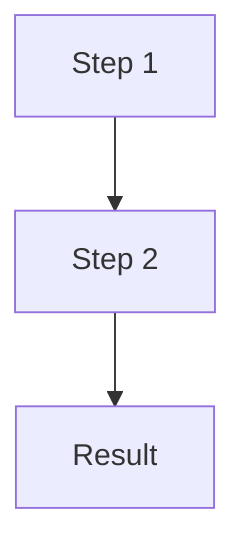

# CLAUDE.md

This file provides guidance to Claude Code (claude.ai/code) when working with code in this repository.

## Project Overview

**para-files** files documents into a PARA tree (Projects, Areas, Resources, Archives). Records are filed by retention, books by ISBN, and everything else is decided by rules and issuers or suggested by an optional cloud model (via litellm and OpenRouter, zero data retention). Nothing moves without `--apply`; every run is journaled and `undo` reverses it. OCR features require macOS (Apple Silicon).

For detailed project information, see the full documentation at [docs/index.md](docs/index.md).

## Build & Development Commands

```bash
# Makefile shortcuts (one-shot alternatives)
make fix           # Auto-fix ruff issues + format in one step
make quality       # Lint + typecheck only (skip tests)
make test-cov      # Tests with missing-line coverage report
make clean         # Remove .pytest_cache, .mypy_cache, dist, etc.
make all           # Full pipeline: setup, lint, format, typecheck, test

# Install dependencies (includes dev tools)
uv sync --all-extras

# Run the application
uv run para-files --help

# Run all quality checks
uv run ruff check src/ tests/      # Lint
uv run ruff format src/ tests/     # Format
uv run mypy src/                   # Type check

# Testing
uv run pytest                      # Run all tests
uv run pytest -v                   # Verbose output
uv run pytest tests/test_cli_sort.py  # Single test file
uv run pytest -k "test_version"    # Run tests matching pattern
uv run pytest --cov                # With coverage report

# Pre-commit hooks (after install)
pre-commit install                 # Install hooks
pre-commit run --all-files         # Run manually
```

## Development Principles

- **KISS** - Keep It Simple, Stupid. Prefer simple solutions over complex ones.
- **DRY** - Don't Repeat Yourself. Extract common patterns into reusable functions.
- **YAGNI** - You Aren't Gonna Need It. Don't add features "just in case".
- **Don't reinvent the wheel** - Use established libraries (loguru, pydantic, etc.).
- **Functional programming** - Prefer pure functions, avoid side effects, use immutable data.

## Code Style

- **Python 3.12+** with strict mypy
- **Ruff** for linting and formatting
- **Line length**: 100 characters
- **Future imports**: `from __future__ import annotations` in all modules
- **Type hints**: Comprehensive typing throughout
- **Package**: Marked as typed (`py.typed` marker present)
- **Logging**: Use `from loguru import logger` (not standard logging)

## Key Files

| File | Purpose |
|------|---------|
| `src/para_files/cli/app.py` | CLI entry point (Typer app; one `*_cmd.py` per command: sort, explain, undo, clean, tree, init) |
| `src/para_files/core/settings.py` | `CoreSettings`: every `PARA_FILES_` setting and the PARA root check |
| `src/para_files/core/tree.py` | Strict loader and validator for `tree.yaml`, `rules.yaml`, `issuers.yaml` |
| `src/para_files/core/evidence.py` | Reads each file once: hash, name, preview, ISBNs, EXIF date, archive listing |
| `src/para_files/core/decide.py` | Cascade, bands, caps, target folder, calibration |
| `src/para_files/core/rules.py`, `books.py`, `issuers.py`, `fallback.py` | The four signals |
| `src/para_files/core/apply.py`, `journal.py`, `undo.py` | Moves, run journal, undo |
| `src/para_files/core/sort.py`, `clean.py`, `secrets.py`, `cache.py` | Sort entry points, clean, secrets guard, SQLite cache |
| `src/para_files/utils/filename_sanitizer.py` | Centralized filename sanitization |
| `src/para_files/core/thema.py` | Thema code lookup and library folders (`thema_folders`) |
| `src/para_files/data/thema_l1l2.json` | Thema folder names (L1/L2), read as package data |
| `examples/` | Sanitized example `tree.yaml`, `rules.yaml`, `issuers.yaml` |
| `tests/core_helpers.py` | Generic example tree and settings for the tests |
| `tests/` | Test suite |

All modules under `src/para_files/` are reachable from the CLI (`tests/test_reachability.py`).

## Filename Sanitization

**All paths and filenames must be filesystem-safe.** Use centralized utilities:

```python
from para_files.utils.filename_sanitizer import sanitize_filename, sanitize_path_component

# For filenames (replaces invalid chars with _)
sanitize_filename("Hello: World#1")  # → "Hello_World_1"

# For path components (preserves spaces, replaces & with 'et')
sanitize_path_component("Arts : généralités")  # → "Arts - généralités"
```

**Invalid characters handled:** `, # " * : < > ? / \ |`

## Thema Book Classification

Books use **hybrid naming**: `{CodeValue}_{ShortName}`

```python
from para_files.core.thema import thema_folders

thema_folders("UB")
# → "U_Informatique_et_technologies_de/UB_Themes_generaux"
```

**Path format:** `3_Resources/livres/{L1_Code_ShortName}/{L2_Code_ShortName}` (the `3_Resources/livres/` part comes from the library leaf in `tree.yaml`)

- Max 2 hierarchy levels after `livres/`
- Accents removed (é→e, ç→c)
- Descriptions shortened and sanitized

## Architecture

### Classification Cascade (core)

Each file goes through the signals in order; the first verdict wins. Secret files are checked first and never reach a signal.

1. **Secrets guard** - name, folder, archive entry or content match: red, never sent or moved
2. **Rules** (confidence 1.0) - filename globs from `rules.yaml`
3. **Books** (1.0 with a verified ISBN, 0.7 heuristic) - ISBN lookup, Thema subject for the library folder
4. **Issuers** (0.95 with a leaf keyword, 0.8 alone) - patterns from `issuers.yaml`
5. **Model fallback** - OpenRouter ranks up to three leaves through litellm; primary then backup model

No verdict means red (stays in place). Bands: rules are green; books are green with an ISBN; issuers and the model are yellow until a kind has `PARA_FILES_CALIBRATION_MIN` confirmed decisions, then green at 0.9 or more. Caps: knowledge is never green; library is green only with an ISBN or an issuer, so library rules stay yellow. `sort --apply` moves green files, `--review` confirms yellow ones; `apply` is sequential, never overwrites, and journals each operation before it happens. `undo` replays the journal backwards.

See [docs/architecture.md](docs/architecture.md) for the diagrams.

## Key Technologies

- **litellm** - Unified LLM API; the fallback calls OpenRouter with `zdr` and data collection denied
- **OpenRouter** - Model gateway for the optional fallback (`OPENROUTER_API_KEY`)
- **Pydantic** - Settings and tree/rules/issuers validation (pydantic-settings for `.env`)
- **Typer** - CLI framework (built on Click)
- **SQLite** - Cache of ISBN lookups and verdicts
- **YAML** - Configuration format
- **Pytest** - Testing framework

## Platform Constraint

OCR features require **macOS** (Apple Silicon) because Vision Framework is macOS-only.
There is no local model server: the core runs without any model on the machine. The cloud fallback is optional and needs an OpenRouter key.

## Documentation

All user-facing documentation is in the `docs/` directory:

- **[Index](docs/index.md)** - Map of the documentation
- **[Getting Started](docs/getting-started.md)** - Install, configure, sort, undo
- **[CLI Reference](docs/cli/overview.md)** - The six commands
- **[Configuration](docs/configuration.md)** - Settings, `tree.yaml`, `rules.yaml`, `issuers.yaml`, validation
- **[Architecture](docs/architecture.md)** - Cascade, bands, journal, cache
- **[Troubleshooting](docs/troubleshooting.md)** - Common failure modes
- **[Archive](docs/archive/README.md)** - Pre-2026-10 pages, for reference only; they do not describe the current tool

**Important**: Keep documentation in sync with code changes. Update `docs/` when making changes, especially for:

- New CLI commands
- Configuration changes
- Architecture modifications
- New features

## Documentation Maintenance

**Always update documentation when making changes:**

| Change Type | Update |
|-------------|--------|
| New feature/command | `CHANGELOG.md` (Unreleased), relevant doc page |
| Bug fix | `CHANGELOG.md` (Unreleased) |
| Architecture change | `docs/architecture.md`, `CHANGELOG.md` |
| Config change | `docs/configuration.md`, `CHANGELOG.md` |
| Breaking change | `CHANGELOG.md` with migration notes |

Before committing:

1. Update `CHANGELOG.md` under `[Unreleased]`
2. Update relevant doc pages in `docs/`
3. Add docstrings for new public functions

## Documentation Preferences

### Diagrams: Use Mermaid

**Never use ASCII box art** - always use **Mermaid diagrams**:



ASCII boxes are fragile across renderers. Mermaid renders consistently.

### Document Structure

- **One topic per file** - Keep pages focused and scannable
- **Use headers** - Clear hierarchy
- **Include examples** - Code examples are essential
- **Link between docs** - Cross-reference related pages
- **Tables over prose** - Use tables for reference material

## Configuration via Environment Variables

Settings use `pydantic-settings` (`CoreSettings` in `core/settings.py`):

| Prefix | Config class | Examples |
|--------|-------------|----------|
| `PARA_FILES_` | `CoreSettings` | `PARA_FILES_PARA_ROOT` (required), `PARA_FILES_FALLBACK_MODEL`, `PARA_FILES_CALIBRATION_MIN`, `PARA_FILES_MAX_WORKERS` |
| none | `CoreSettings` | `OPENROUTER_API_KEY` (also accepted as `PARA_FILES_OPENROUTER_API_KEY`, `PARA_FILES_LLM_API_KEY`) |

Priority: init arguments > environment variables > `~/.config/para-files/.env` (or `$PARA_FILES_CONFIG_DIR/.env`) > defaults. There is no YAML settings source. The full table is in [docs/configuration.md](docs/configuration.md#settings).

## CLI Module Pattern

Commands live in `src/para_files/cli/`. Each `*_cmd.py` imports `app` from `cli/app.py` and registers one command with `@app.command()`; `cli/__init__.py` imports every command module. The entry point is `para_files.cli.app:app`. Shared helpers: `cli/common.py` (settings and context with readable errors), `cli/output.py` (plan printing, JSON), `cli/review.py` (the `--review` loop). Commands call `para_files.core`; they never import the old pipeline.

To add a command:
1. Create `src/para_files/cli/yourcommand_cmd.py` with `@app.command("yourcommand")` (Typer)
2. Import the module in `src/para_files/cli/__init__.py`
3. Add tests in `tests/test_cli_yourcommand.py` (use `tests.core_helpers.setup_cli`)

## Performance Notes

- Classification runs in a thread pool (`PARA_FILES_MAX_WORKERS`, default 4; `sort --workers` overrides it)
- SQLite cache (`PARA_FILES_CACHE_PATH`): ISBN lookups and verdicts keyed by content hash and config fingerprint, so `sort` then `sort --apply` asks the model once per file
- `apply` runs sequentially; each operation is journaled and fsynced before it happens
- Config is loaded once per run (`build_context`); a model is asked only when a key is set and the fallback is enabled

<!-- rtk-instructions v2 -->
# RTK (Rust Token Killer) - Token-Optimized Commands

## Golden Rule

**Always prefix commands with `rtk`**. If RTK has a dedicated filter, it uses it. If not, it passes through unchanged. This means RTK is always safe to use.

**Important**: Even in command chains with `&&`, use `rtk`:
```bash
# ❌ Wrong
git add . && git commit -m "msg" && git push

# ✅ Correct
rtk git add . && rtk git commit -m "msg" && rtk git push
```

## RTK Commands by Workflow

### Build & Compile (80-90% savings)
```bash
rtk cargo build         # Cargo build output
rtk cargo check         # Cargo check output
rtk cargo clippy        # Clippy warnings grouped by file (80%)
rtk tsc                 # TypeScript errors grouped by file/code (83%)
rtk lint                # ESLint/Biome violations grouped (84%)
rtk prettier --check    # Files needing format only (70%)
rtk next build          # Next.js build with route metrics (87%)
```

### Test (90-99% savings)
```bash
rtk cargo test          # Cargo test failures only (90%)
rtk vitest run          # Vitest failures only (99.5%)
rtk playwright test     # Playwright failures only (94%)
rtk test <cmd>          # Generic test wrapper - failures only
```

### Git (59-80% savings)
```bash
rtk git status          # Compact status
rtk git log             # Compact log (works with all git flags)
rtk git diff            # Compact diff (80%)
rtk git show            # Compact show (80%)
rtk git add             # Ultra-compact confirmations (59%)
rtk git commit          # Ultra-compact confirmations (59%)
rtk git push            # Ultra-compact confirmations
rtk git pull            # Ultra-compact confirmations
rtk git branch          # Compact branch list
rtk git fetch           # Compact fetch
rtk git stash           # Compact stash
rtk git worktree        # Compact worktree
```

Note: Git passthrough works for ALL subcommands, even those not explicitly listed.

### GitHub (26-87% savings)
```bash
rtk gh pr view <num>    # Compact PR view (87%)
rtk gh pr checks        # Compact PR checks (79%)
rtk gh run list         # Compact workflow runs (82%)
rtk gh issue list       # Compact issue list (80%)
rtk gh api              # Compact API responses (26%)
```

### JavaScript/TypeScript Tooling (70-90% savings)
```bash
rtk pnpm list           # Compact dependency tree (70%)
rtk pnpm outdated       # Compact outdated packages (80%)
rtk pnpm install        # Compact install output (90%)
rtk npm run <script>    # Compact npm script output
rtk npx <cmd>           # Compact npx command output
rtk prisma              # Prisma without ASCII art (88%)
```

### Files & Search (60-75% savings)
```bash
rtk ls <path>           # Tree format, compact (65%)
rtk read <file>         # Code reading with filtering (60%)
rtk grep <pattern>      # Search grouped by file (75%)
rtk find <pattern>      # Find grouped by directory (70%)
```

### Analysis & Debug (70-90% savings)
```bash
rtk err <cmd>           # Filter errors only from any command
rtk log <file>          # Deduplicated logs with counts
rtk json <file>         # JSON structure without values
rtk deps                # Dependency overview
rtk env                 # Environment variables compact
rtk summary <cmd>       # Smart summary of command output
rtk diff                # Ultra-compact diffs
```

### Infrastructure (85% savings)
```bash
rtk docker ps           # Compact container list
rtk docker images       # Compact image list
rtk docker logs <c>     # Deduplicated logs
rtk kubectl get         # Compact resource list
rtk kubectl logs        # Deduplicated pod logs
```

### Network (65-70% savings)
```bash
rtk curl <url>          # Compact HTTP responses (70%)
rtk wget <url>          # Compact download output (65%)
```

### Meta Commands
```bash
rtk gain                # View token savings statistics
rtk gain --history      # View command history with savings
rtk discover            # Analyze Claude Code sessions for missed RTK usage
rtk proxy <cmd>         # Run command without filtering (for debugging)
rtk init                # Add RTK instructions to CLAUDE.md
rtk init --global       # Add RTK to ~/.claude/CLAUDE.md
```

## Token Savings Overview

| Category | Commands | Typical Savings |
|----------|----------|-----------------|
| Tests | vitest, playwright, cargo test | 90-99% |
| Build | next, tsc, lint, prettier | 70-87% |
| Git | status, log, diff, add, commit | 59-80% |
| GitHub | gh pr, gh run, gh issue | 26-87% |
| Package Managers | pnpm, npm, npx | 70-90% |
| Files | ls, read, grep, find | 60-75% |
| Infrastructure | docker, kubectl | 85% |
| Network | curl, wget | 65-70% |

Overall average: **60-90% token reduction** on common development operations.
<!-- /rtk-instructions -->