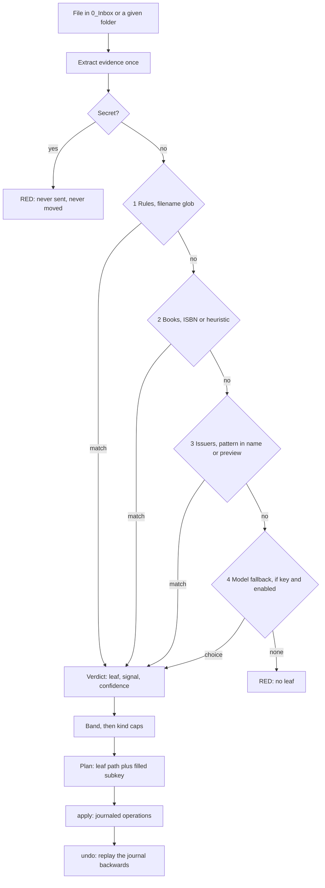
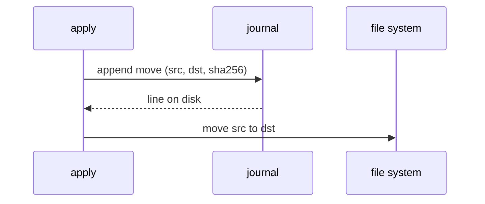

# Architecture

para-files decides where a file goes in a cascade, bands the decision by how much it can be trusted, and only then moves anything, through a journal that makes every run reversible. The design is in [the redesign spec](superpowers/specs/2026-10-10-para-files-redesign-design.md) (section 4); this page describes what the code does.

## Pipeline

The first signal with a verdict wins. A signal that raises is logged and the next one runs.

## Modules

| Module | Role |
|---|---|
| `core/settings.py` | Settings from init arguments, environment, `.env`, defaults |
| `core/tree.py` | Strict loading and validation of `tree.yaml`, `rules.yaml`, `issuers.yaml` |
| `core/evidence.py` | Reads each file once: hash, name, text preview, ISBNs, EXIF date, archive listing |
| `core/secrets.py` | Secret guard: name and content patterns |
| `core/rules.py`, `core/books.py`, `core/issuers.py`, `core/fallback.py` | The four signals |
| `core/decide.py` | Cascade, bands, caps, target folder, calibration |
| `core/sort.py` | Entry points: find files, classify in parallel, apply |
| `core/apply.py` | Sequential moves: never overwrites, journals each operation |
| `core/journal.py` | Run journal, run ids, owner-decision counts |
| `core/undo.py` | Reverses a run from its journal |
| `core/clean.py` | Junk, empty folders and duplicates to `.trash` |
| `core/cache.py` | SQLite cache of ISBN lookups and verdicts |

## Secrets guard

Secrets are checked before any signal runs. A file is secret when:

- its name matches a secret pattern (for example `password`, `token`, `api key`, `login`, `recovery phrase`, `.env`, `id_rsa`, `.pem`, `.kdbx`);
- a folder between the PARA root and the file has such a name;
- an archive entry has such a name;
- its first 100,000 characters of text contain a credential line (a labelled value such as `password: ...`), a private key block, a cloud access key, a recovery phrase or a vault key.

A secret file carries only filesystem facts. It is never sent to the model, never moved and never trashed. The plan lists secrets under their own heading. Name matching deliberately over-flags, so a false positive stays local; there is no override.

## Signals

| # | Signal | Decides when | Confidence |
|---|---|---|---|
| 1 | Rules | A filename glob matches (first rule in file order) | 1.0 |
| 2 | Books | A PDF, EPUB or MOBI has an ISBN whose lookup title matches the filename (`1.0`), or looks like a book (`0.7`) | 1.0 or 0.7 |
| 3 | Issuers | An issuer pattern appears in the filename or text preview | 0.95 if a leaf keyword agrees, else 0.8 |
| 4 | Model | OpenRouter ranks up to three leaves; the first is the choice | the model's probability |

Book lookups go to public metadata services and the ISBN is checked against the filename, so an ISBN printed in an unrelated document does not file it. EPUB and MOBI files always count as books for the heuristic; a PDF needs at least 50 pages and a book-like structure. The Thema subject code of a book becomes its library subfolder.

Issuer patterns of three characters or fewer match whole words only. Among an issuer's leaves, the one whose keywords appear most wins; a tie goes to the first leaf listed.

The model sees the file name, a preview of the text (`preview_chars`), archive entries and the menu of leaves with their descriptions and keywords. It never sees the path, and secret-named leaves are never offered.

## Bands and caps

Each verdict gets a band from its signal, then the kind of the chosen leaf caps it.

| Verdict | Band before caps |
|---|---|
| Rules | green |
| Book with a verified ISBN | green |
| Book by heuristic | yellow |
| Issuer, or model, with confidence below `fallback_red` (model only) | red |
| Issuer or model, confidence at or above its green threshold (default 0.9), and kind calibrated | green |
| Issuer or model otherwise | yellow |
| No leaf | red |

Issuer matches alone score 0.8, below the default threshold, so they stay yellow until you lower `PARA_FILES_ISSUERS_GREEN` to 0.8 or below.

Caps, applied after the band:

- **knowledge** leaves are never green (yellow at most);
- **library** leaves are green only with a verified ISBN or an issuer match; rules and heuristic books stay yellow.

**Calibration.** Issuer and model matches stay yellow until the kind (record, library, media, knowledge) has `PARA_FILES_CALIBRATION_MIN` (default 100) decisions you confirmed. Confirmed decisions are the owner-decided moves and confirmations in journals not undone, counted per kind. `sort --apply --review` is what produces them, and `para-files tree` shows the progress per kind together with how often the tool's proposal was right.

## Plan and apply

The target folder is the leaf path plus its subkey. Each placeholder is filled from the verdict or the file:

| Placeholder | Filled from |
|---|---|
| `{year}`, `{month}` | EXIF date, else a date in the filename |
| `{issuer}` | The issuer match |
| `{thema}` | The Thema code of the ISBN |

If any placeholder cannot be filled, the file goes to the leaf's root folder.

`apply` runs the operations one after another, never in parallel, and refuses to:

- move a secret, an unknown leaf, a missing or symlinked source, or a file whose content changed since the preview (its hash is checked again);
- write outside the PARA root;
- overwrite anything: an existing identical file sends the source to `.trash`; a different one gets `name (2).ext`, `name (3).ext`, and so on.

A file already in its target is skipped; if you confirmed it, the confirmation is still journaled. Folders the run emptied are removed, except bucket and leaf folders.

Classification runs in a thread pool (`max_workers`); `apply` does not. Nothing changes on disk until `apply`.

### Write-ahead journal

Each operation is written and fsynced to the journal before it happens.

| Operation | Meaning |
|---|---|
| `mkdir` | A folder the run created |
| `move` | A file moved from `src` to `dst` |
| `trash` | A file moved into `.trash/<run id>/` |
| `rmdir` | An empty folder the run removed |
| `confirm` | A file already in place that you confirmed |

Each journal is `journal/<run id>.jsonl` under `PARA_FILES_STATE_DIR`. A run id is the local time `YYYYMMDD-HHMMSS`, with `-2`, `-3` appended when taken. A torn last line from a crash is ignored. A run with no operations leaves no journal.

## Undo

`undo` replays the journal newest first and checks each step:

- `move` and `trash`: the file is moved back only if it is still at `dst`, has the journaled hash, and the original path is free; otherwise it is left alone, with the reason.
- `rmdir`: the folder is recreated.
- `mkdir`: the folder is removed if empty.

A run is marked undone (`<run id>.undone`) only when nothing was left alone. A run with skipped steps stays undoable.

## Cache

`PARA_FILES_CACHE_PATH` is a SQLite file with two tables:

- **ISBN lookups:** only successful lookups are stored, so a network failure is retried next time.
- **Verdicts:** keyed by the file's content hash and a configuration fingerprint. The fingerprint hashes `tree.yaml`, `rules.yaml`, `issuers.yaml` (missing counts as empty) and the primary model id. Editing any of them, or changing the model, starts verdicts afresh. The filename is part of the key, since rules and issuers read it.

So a `sort` preview followed by `sort --apply` reuses the preview's verdicts and does not ask the model again for the same content.

## Clean

`clean` is separate from the cascade. It trashes junk files (`.DS_Store`, `Thumbs.db`, `desktop.ini`, Office lock files, AppleDouble files), removes folders left empty, and with `--duplicates` trashes identical copies, keeping one original. It is journaled like `sort`, and it never follows symlinks or enters dot-folders. See [CLI overview](cli/overview.md).
