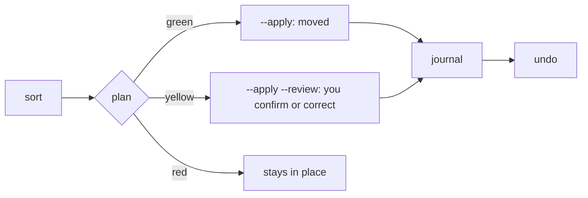

# CLI overview

`para-files` has six commands. Every command that changes files previews by default and acts only with `--apply`. Every applied run is journaled and can be reversed with `undo`.

| Command | What it does |
|---|---|
| [`sort`](sort.md) | Classify files (default: `0_Inbox`), show the plan, move them with `--apply` |
| [`explain`](explain.md) | Show why one file goes where it goes, and what to edit to change it |
| [`undo`](undo.md) | Reverse a run from its journal |
| [`clean`](clean.md) | Junk files, empty folders and identical duplicates to `.trash` |
| [`tree`](tree.md) | Leaves, settings, calibration progress and config warnings |
| [`init`](init.md) | Create `0_Inbox` and the leaf folders `tree.yaml` expects |

## Settings

Settings come from the environment, then `~/.config/para-files/.env`, then defaults. The one you must set is `PARA_FILES_PARA_ROOT`: the folder that holds `0_Inbox` … `4_Archives`. The tree itself lives in `~/.config/para-files/tree.yaml`, `rules.yaml` and `issuers.yaml`.

| Variable | Default | Meaning |
|---|---|---|
| `PARA_FILES_PARA_ROOT` | (required) | The PARA root |
| `PARA_FILES_MAX_WORKERS` | `4` | Parallel classifiers |
| `PARA_FILES_FALLBACK_ENABLED` | `true` | Ask the model when rules, books and issuers find nothing |
| `OPENROUTER_API_KEY` | (none) | Key for the model; without it the model is never asked |
| `PARA_FILES_CALIBRATION_MIN` | `100` | Confirmed decisions per kind before issuers and the model may go green |

## Bands

- **green**: moved by `sort --apply`.
- **yellow**: moved only after you confirm it in `sort --apply --review`.
- **red**: stays where it is.

Until a kind of document (record, library, media, knowledge) has 100 decisions you confirmed, only rules and books with an ISBN can be green. Knowledge files are never green.
