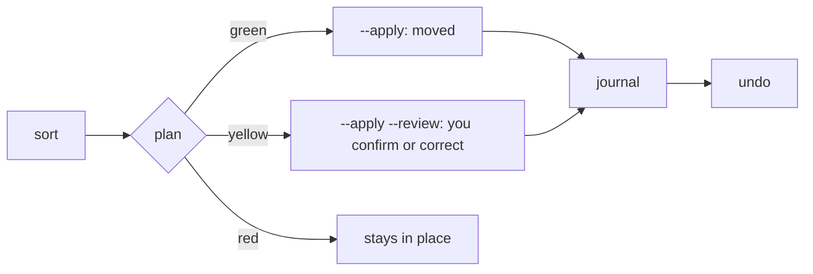

# CLI overview

`para-files` has six commands. Every command that moves or trashes files previews by default and acts only with `--apply`; `undo` reverses a run directly, checking each step first. Every applied run is journaled and can be reversed with `undo`.

| Command | What it does |
|---|---|
| [`sort`](sort.md) | Classify files (default: `0_Inbox`), show the plan, move them with `--apply` |
| [`explain`](explain.md) | Show why one file goes where it goes, and what to edit to change it |
| [`undo`](undo.md) | Reverse a run from its journal |
| [`clean`](clean.md) | Junk files, empty folders and identical duplicates to `.trash` |
| [`tree`](tree.md) | Leaves, settings, calibration progress and config warnings |
| [`init`](init.md) | Create `0_Inbox` and the leaf folders `tree.yaml` expects |

## Global options

- `--verbose/-v` shows debug logs on stderr. By default only warnings are shown, so stdout (including `--json`) stays clean.

## Settings

Settings come from the environment, then `~/.config/para-files/.env`, then defaults. The one you must set is `PARA_FILES_PARA_ROOT`: the folder that holds `0_Inbox` … `4_Archives`. The tree itself lives in `~/.config/para-files/tree.yaml`, `rules.yaml` and `issuers.yaml`.

| Variable | Default | Meaning |
|---|---|---|
| `PARA_FILES_PARA_ROOT` | (required) | The PARA root |
| `PARA_FILES_MAX_WORKERS` | `4` | Parallel classifiers |
| `PARA_FILES_FALLBACK_ENABLED` | `true` | Ask the model for every file that no verified ISBN or pinned rule decides |
| `OPENROUTER_API_KEY` | (none) | Key for the model; without it the model is never asked |
| `PARA_FILES_CALIBRATION_MIN` | `100` | Confirmed decisions per kind before model matches may go green |

## Bands

- **green**: moved by `sort --apply`.
- **yellow**: moved only after you confirm it in `sort --apply --review`.
- **red**: stays where it is.

Pinned rules and books with a verified ISBN are green from the start. Model verdicts stay yellow until that kind of document (record, library, media, knowledge) has 100 decisions you confirmed, and then are green only at confidence 0.9 or more. Hints (unpinned rules, heuristic books, issuer matches) are always yellow. Knowledge files are never green; library files are green only with an ISBN or an issuer match.
