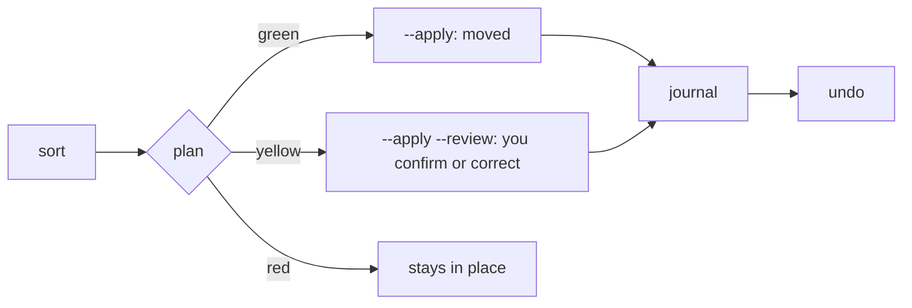

# Stage 3 — CLI Cut-over Implementation Plan

> **For agentic workers:** REQUIRED SUB-SKILL: Use superpowers:subagent-driven-development (recommended) or superpowers:executing-plans to implement this plan task-by-task. Steps use checkbox (`- [ ]`) syntax for tracking.

**Goal:** Replace the old 18-command CLI with the six commands of spec §4.4 (`sort`, `explain`, `undo`, `clean`, `tree`, `init`), all built on `para_files.core`, and run the first real `sort` on `0_Inbox`.

**Architecture:** `src/para_files/cli/` keeps the Typer app pattern: `app.py` holds the app, each `*_cmd.py` registers one command, and `cli/__init__.py` imports them. The entry point becomes `para_files.cli.app:app`. Shared plumbing (`common.py`: settings and context with readable errors; `output.py`: plan printing and the JSON shape; `review.py`: the interactive confirmation loop) keeps the commands thin. Two core additions: `core/clean.py`, and `signal_verdicts` / `decision_for` in `core/decide.py` for `explain`.

**Tech Stack:** Python 3.12, Typer (`typer.testing.CliRunner` in tests), the Stage 2 core.

**Spec:** `docs/superpowers/specs/2026-10-10-para-files-redesign-design.md` (§4.3, §4.4, §5 Stage 3).

## Global Constraints

- Every module starts with `from __future__ import annotations`; line length 100; the repo's strict ruff config and `mypy src/` must pass. `src/para_files/cli/**` may use FBT002, PLR0913 and PLR0917 (existing per-file ignores).
- Every mutating command previews by default and acts only with `--apply` (spec §4.3). Every applied run is journaled.
- Secret files are never sent and never moved, renamed or trashed (spec §4.3).
- The repo is PUBLIC: no personal names, paths or real issuers in tracked files; tests use the generic tree in `tests/core_helpers.py`.
- No network in tests: the fallback is off in every CLI test (`PARA_FILES_FALLBACK_ENABLED=false`).
- Model calls go through litellm only (owner rule); this plan adds none.
- Gate before every commit: `uv run pytest -m "not slow" -o addopts="-ra --strict-markers --strict-config"`, `uv run ruff check src/ tests/ scripts/`, `uv run ruff format --check src/ tests/ scripts/`, `uv run mypy src/`.
- Commit messages end with your usual Co-Authored-By trailer plus `Claude-Session: https://claude.ai/code/session_01TnHHvHPS4t1tVuqpTZiEJx`. Stage files explicitly; never stage `.serena/`, `.rtk/` or `uv.lock`.

## Rulings made while writing this plan

| Question | Ruling | Why |
|---|---|---|
| Spec: "old commands and modules deleted" | This plan deletes the old CLI (`cli/*_cmd.py`, `cli/shared.py`, `main.py`) and their tests. The old internal modules (`pipeline.py`, `classifiers/`, `mover.py`, `learner.py`…) go in the Stage 4 purge | Keeps this branch reviewable; nothing in the new CLI imports them; `scripts/run_baseline.py` still does |
| `sort --review` without `--apply` | Refused with a message | Spec: nothing changes without `--apply`; the files you confirm are moved |
| `explain` and the model | The model is asked only with `--ask-model` | `explain` promises no side effects; asking the model sends the file's name and text to the cloud |
| `init` when `0_Inbox` does not exist yet | `init [ROOT]` takes the root as an argument; without it, the settings' root | The settings refuse a root without `0_Inbox`, which is what `init` creates |
| `clean` outside the PARA root | Refused | `.trash` lives in the PARA root; trashing files from elsewhere would move them into it |
| Calibration progress (S1/S2) | Shown by `tree` per kind: confirmed decisions and how often the proposal was right | Spec §4.4: `tree` shows the effective state; the numbers come from the journal |
| `update-formula` release job | Removed now (spec had it in Stage 4) | It fails on every release (protected `main`) and emails the owner each time |
| Old how-to pages under `docs/tasks/`, `docs/getting-started/` | Left for the Stage 4 docs reduction | They describe the old pipeline throughout; only `docs/cli/`, README and CLAUDE.md change here |

## Review Focus

1. `sort --apply --review` when the input ends early (EOF, Ctrl+D) → what was confirmed so far is applied, nothing crashes (Task 3, `typer.Abort` is caught in `review_ops`).
2. A leaf typed during review that matches several ids → refused with "unknown or ambiguous", asked again (Task 3).
3. `PARA_FILES_PARA_ROOT` missing or pointing at a bucket → exit code 2 with a message naming the variable, for every command (Tasks 2, 6).
4. `explain` on a secret file → only the reason; no preview, no signal runs (Task 4).
5. `clean --apply` then `undo` → byte-identical tree, `.trash` gone (Task 7).

## File Structure

| File | Responsibility |
|---|---|
| `src/para_files/cli/app.py` | The Typer app and `--version` |
| `src/para_files/cli/common.py` | `fail`, `settings_or_exit`, `context_or_exit`, `relative` |
| `src/para_files/cli/output.py` | Plan and report printing; the JSON shape |
| `src/para_files/cli/review.py` | The `--review` loop |
| `src/para_files/cli/{sort,explain,undo,clean,tree,init}_cmd.py` | One command each |
| `src/para_files/core/clean.py` | `plan_clean`, `apply_clean` |
| `tests/test_cli_*.py`, `tests/test_core_clean.py` | Tests |

---

### Task 1: Remove the failing Homebrew release job

**Files:**
- Modify: `.github/workflows/release.yml` (delete the whole `update-formula:` job, from the line `  update-formula:` to the end of its last step)
- Delete: `Formula/para-files.rb` (and the `Formula/` folder)

- [ ] **Step 1:** Delete the `update-formula` job from `.github/workflows/release.yml`. Nothing else in the file references it (check: `grep -n "update-formula\|Formula" .github/workflows/release.yml` prints nothing afterwards).
- [ ] **Step 2:** `git rm -r Formula`. Check that nothing else references it: `grep -rn "Formula/" --include=*.md --include=*.yml --include=*.toml . | grep -v "^./docs/superpowers"` prints nothing (the spec and plans mention it as history; leave them).
- [ ] **Step 3:** Validate the workflow is still well-formed YAML: `uv run python -c "import yaml,sys; yaml.safe_load(open('.github/workflows/release.yml'))"`.
- [ ] **Step 4: Commit.**

```bash
git add .github/workflows/release.yml
git commit -m "ci(release): drop the update-formula job and the Homebrew formula" -m "The job pushed to protected main and failed on every release since v1.6.

Co-Authored-By: <your trailer>
Claude-Session: https://claude.ai/code/session_01TnHHvHPS4t1tVuqpTZiEJx"
```

(The `git rm` in Step 2 already staged the deletion.)

---

### Task 2: Cut over to the new app

**Files:**
- Delete: `src/para_files/main.py`, every `src/para_files/cli/*_cmd.py`, `src/para_files/cli/shared.py`
- Delete tests of the old CLI: `tests/test_main.py`, `tests/test_migrate_cmd.py`, `tests/test_rescan_cmd.py`, `tests/test_routes_cmd.py`, `tests/test_dedupe_cmd.py`, `tests/test_learn_cmd.py`, `tests/test_inbox_cmd.py`, `tests/test_scan_cmd.py`, `tests/test_classify_cmd.py`, `tests/test_bookstore_cmd.py`, `tests/test_parallel.py`, `tests/test_concurrent_move.py`, `tests/test_move_cmd_safety.py`, `tests/test_cli_shared_interrupt.py`, `tests/test_single_thread_threshold.py`
- Modify: `pyproject.toml` (entry point; drop the `main.py` per-file ignore), `src/para_files/__init__.py`, `tests/core_helpers.py`
- Create/replace: `src/para_files/cli/__init__.py`, `src/para_files/cli/app.py`, `src/para_files/cli/common.py`, `tests/test_cli_app.py`

**Interfaces:**
- Produces: `para_files.cli.app.app` (Typer), `para_files.cli.common.fail(message, code=2) -> NoReturn`, `settings_or_exit(**overrides) -> CoreSettings`, `context_or_exit(settings) -> Context`, `relative(path, root) -> str`, constants `EXIT_FAILURE = 1`, `EXIT_USAGE = 2`; `tests.core_helpers.setup_cli(base, monkeypatch) -> Path` (the PARA root).

- [ ] **Step 1: Delete the old CLI and its tests.**

```bash
git rm src/para_files/main.py src/para_files/cli/*_cmd.py src/para_files/cli/shared.py \
  tests/test_main.py tests/test_migrate_cmd.py tests/test_rescan_cmd.py tests/test_routes_cmd.py \
  tests/test_dedupe_cmd.py tests/test_learn_cmd.py tests/test_inbox_cmd.py tests/test_scan_cmd.py \
  tests/test_classify_cmd.py tests/test_bookstore_cmd.py tests/test_parallel.py \
  tests/test_concurrent_move.py tests/test_move_cmd_safety.py tests/test_cli_shared_interrupt.py \
  tests/test_single_thread_threshold.py
```

Then `grep -rn "para_files.main\|para_files.cli.shared\|from para_files.cli import" src tests scripts` must print only `src/para_files/__init__.py` and `src/para_files/cli/__init__.py` (both fixed below).

- [ ] **Step 2: Entry point and package exports.**
  - `pyproject.toml`: replace `para-files = "para_files.main:cli"` with `para-files = "para_files.cli.app:app"`, and delete the whole `"src/para_files/main.py" = [ … ]` block in `[tool.ruff.lint.per-file-ignores]`.
  - `src/para_files/__init__.py`: delete the line `from para_files.main import cli, main` and the two entries `"cli",` and `"main",` in `__all__`.

- [ ] **Step 3: Test helper.** Append to `tests/core_helpers.py`:

```python
def setup_cli(base: Path, monkeypatch: Any) -> Path:
    """A PARA root and the small tree in the sandbox config dir, wired through the env.

    Returns the PARA root. The cache and journal live under base, outside the root;
    the fallback is off.
    """
    import os

    root = make_para_root(base)
    write_config(Path(os.environ["PARA_FILES_CONFIG_DIR"]))
    monkeypatch.setenv("PARA_FILES_PARA_ROOT", str(root))
    monkeypatch.setenv("PARA_FILES_CACHE_PATH", str(base / "cache" / "cache.sqlite"))
    monkeypatch.setenv("PARA_FILES_STATE_DIR", str(base / "state"))
    monkeypatch.setenv("PARA_FILES_FALLBACK_ENABLED", "false")
    return root
```

- [ ] **Step 4: Write the failing tests.** Create `tests/test_cli_app.py`:

```python
"""The CLI app: --version, help without arguments, the entry point."""

from __future__ import annotations

import tomllib
from pathlib import Path

from typer.testing import CliRunner

from para_files import __version__
from para_files.cli import app


runner = CliRunner()


def test_version():
    result = runner.invoke(app, ["--version"])
    assert result.exit_code == 0
    assert result.output.strip() == f"para-files {__version__}"


def test_no_arguments_shows_help():
    result = runner.invoke(app, [])
    assert "Usage" in result.output


def test_entry_point_targets_the_new_app():
    pyproject = Path(__file__).resolve().parent.parent / "pyproject.toml"
    scripts = tomllib.loads(pyproject.read_text(encoding="utf-8"))["project"]["scripts"]
    assert scripts == {"para-files": "para_files.cli.app:app"}
```

Run `uv run pytest tests/test_cli_app.py -q` → fails (old `cli/__init__.py` imports deleted modules).

- [ ] **Step 5: Implement.** Replace `src/para_files/cli/app.py` with:

```python
"""The para-files Typer app; each ``*_cmd`` module registers one command on it."""

from __future__ import annotations

from typing import Annotated

import typer


app = typer.Typer(
    name="para-files",
    help="File documents into a PARA tree: preview first, apply on request, undo any run.",
    no_args_is_help=True,
    add_completion=False,
)


def _show_version(value: bool) -> None:  # noqa: FBT001 - Typer option callback signature
    if value:
        from para_files import __version__

        typer.echo(f"para-files {__version__}")
        raise typer.Exit


@app.callback()
def main(
    version: Annotated[
        bool,
        typer.Option(
            "--version", "-V", callback=_show_version, is_eager=True, help="Show the version."
        ),
    ] = False,
) -> None:
    """File documents into a PARA tree: preview first, apply on request, undo any run."""
```

Create `src/para_files/cli/common.py`:

```python
"""Shared CLI plumbing: settings and run context with readable errors."""

from __future__ import annotations

from pathlib import Path
from typing import Any, NoReturn

import typer
from pydantic import ValidationError

from para_files.core.decide import Context
from para_files.core.settings import CoreSettings, load_settings
from para_files.core.sort import build_context
from para_files.core.tree import TreeError


EXIT_FAILURE = 1
EXIT_USAGE = 2
ROOT_HINT = "set PARA_FILES_PARA_ROOT in the environment or in ~/.config/para-files/.env"


def fail(message: str, code: int = EXIT_USAGE) -> NoReturn:
    """Print an error on stderr and exit."""
    typer.echo(f"error: {message}", err=True)
    raise typer.Exit(code)


def _describe(exc: ValidationError) -> str:
    parts = []
    for error in exc.errors():
        where = ".".join(str(item) for item in error["loc"]) or "settings"
        hint = f" ({ROOT_HINT})" if where == "para_root" else ""
        parts.append(f"{where}: {error['msg']}{hint}")
    return "; ".join(parts)


def settings_or_exit(**overrides: Any) -> CoreSettings:  # noqa: ANN401 - settings overrides
    """Load settings, or exit with a message naming what is wrong."""
    try:
        return load_settings(**overrides)
    except ValidationError as exc:
        fail(_describe(exc))


def context_or_exit(settings: CoreSettings) -> Context:
    """Load the tree config and open the cache, or exit with the config error."""
    try:
        return build_context(settings)
    except TreeError as exc:
        fail(str(exc))


def relative(path: Path, root: Path) -> str:
    """path relative to the PARA root when inside it, else as given."""
    try:
        return path.resolve().relative_to(root.resolve()).as_posix()
    except ValueError:
        return str(path)
```

Replace `src/para_files/cli/__init__.py` with (later tasks add their command module to the import list):

```python
"""Command-line interface: six commands on one Typer app (spec §4.4).

Importing this package registers every command on ``para_files.cli.app.app``.
"""

from __future__ import annotations

from para_files.cli.app import app


__all__ = ["app"]
```

- [ ] **Step 6: Run, expect pass.** `uv run pytest tests/test_cli_app.py -q` → 3 passed. Then the full gate. `uv run para-files --version` prints `para-files <version>`.

- [ ] **Step 7: Commit.** Stage the deletions (already staged by `git rm`), `pyproject.toml`, `src/para_files/__init__.py`, `src/para_files/cli/`, `tests/core_helpers.py`, `tests/test_cli_app.py`; message `feat(cli)!: cut over to the new app; remove the old commands`.

---

### Task 3: `sort` (plan, JSON, apply, review)

**Files:**
- Create: `src/para_files/cli/output.py`, `src/para_files/cli/review.py`, `src/para_files/cli/sort_cmd.py`, `tests/test_cli_sort.py`
- Modify: `src/para_files/cli/__init__.py` (import `sort_cmd`)

**Interfaces:**
- Consumes: Task 2 (`fail`, `settings_or_exit`, `context_or_exit`, `relative`); core `preview`, `auto_ops`, `apply`, `Op`, `ApplyReport`, `Decision`, `INBOX`.
- Produces: `output.decision_dict(decision, root)`, `summary(decisions)`, `print_plan(decisions, root)`, `report_dict(run_id, report, root)`, `print_report(run_id, report, root)`; `review.review_ops(decisions, config, root, ask=…) -> list[Op]`, `resolve_leaf(text, config) -> str | None`.

Behaviour: `sort [PATH…]` (default `<root>/0_Inbox`) prints the band-grouped plan (or JSON with `--json`). `--apply` moves the green files; `--apply --review` also asks about each yellow file (Enter accept, `s` skip, `q` stop, `?` list leaves, or a leaf id / unique prefix). Confirmed and corrected files are journaled with `decided_by: owner`. Secrets are listed under their own heading and never moved.

- [ ] **Step 1: Write the failing tests.** Create `tests/test_cli_sort.py`:

```python
"""`sort`: preview by default, --apply moves green, --review confirms yellow."""

from __future__ import annotations

import json

from typer.testing import CliRunner

from para_files.cli import app
from para_files.core.journal import confirmed_counts, last_run_id, read_run
from tests.core_helpers import make_config, setup_cli


runner = CliRunner()


def put(root, rel, text="x"):
    path = root / rel
    path.parent.mkdir(parents=True, exist_ok=True)
    path.write_text(text)
    return path


def test_preview_moves_nothing(tmp_path, monkeypatch, snapshot):
    root = setup_cli(tmp_path, monkeypatch)
    put(root, "0_Inbox/Payslip_2025-12.txt", "payslip")
    put(root, "0_Inbox/notes.md", "# notes")
    before = snapshot(root)
    result = runner.invoke(app, ["sort"])
    assert result.exit_code == 0, result.output
    assert "GREEN (1)" in result.output
    assert "YELLOW (1)" in result.output
    assert "Payslip_2025-12.txt  ->  4_Archives/10y_travail/2025" in result.output
    assert snapshot(root) == before


def test_apply_moves_green_only(tmp_path, monkeypatch):
    root = setup_cli(tmp_path, monkeypatch)
    put(root, "0_Inbox/Payslip_2025-12.txt", "payslip")
    notes = put(root, "0_Inbox/notes.md", "# notes")
    result = runner.invoke(app, ["sort", "--apply"])
    assert result.exit_code == 0, result.output
    assert (root / "4_Archives/10y_travail/2025/Payslip_2025-12.txt").exists()
    assert notes.exists()
    assert "1 moved" in result.output
    assert "undo with: para-files undo" in result.output


def test_review_accept_and_correct(tmp_path, monkeypatch):
    root = setup_cli(tmp_path, monkeypatch)
    put(root, "0_Inbox/a_notes.md", "# a")
    put(root, "0_Inbox/b_notes.md", "# b")
    result = runner.invoke(app, ["sort", "--apply", "--review"], input="\narchives_5y\n")
    assert result.exit_code == 0, result.output
    assert (root / "3_Resources/IT/a_notes.md").exists()
    assert (root / "4_Archives/5y_factures/b_notes.md").exists()
    entries = read_run(tmp_path / "state", last_run_id(tmp_path / "state"))
    moves = [(e["leaf"], e["proposed_leaf"], e["decided_by"]) for e in entries if e["op"] == "move"]
    assert moves == [
        ("resources_it", "resources_it", "owner"),
        ("archives_5y_factures", "resources_it", "owner"),
    ]
    assert confirmed_counts(tmp_path / "state", make_config().tree) == {
        "knowledge": 1,
        "record": 1,
    }


def test_review_skip_unknown_and_stop(tmp_path, monkeypatch):
    root = setup_cli(tmp_path, monkeypatch)
    a = put(root, "0_Inbox/a_notes.md", "# a")
    b = put(root, "0_Inbox/b_notes.md", "# b")
    result = runner.invoke(app, ["sort", "--apply", "--review"], input="nope\ns\nq\n")
    assert result.exit_code == 0, result.output
    assert "unknown or ambiguous leaf: 'nope'" in result.output
    assert a.exists()
    assert b.exists()


def test_review_needs_apply(tmp_path, monkeypatch):
    setup_cli(tmp_path, monkeypatch)
    result = runner.invoke(app, ["sort", "--review"])
    assert result.exit_code == 2
    assert "--review needs --apply" in result.output


def test_json_plan(tmp_path, monkeypatch):
    root = setup_cli(tmp_path, monkeypatch)
    put(root, "0_Inbox/Payslip_2025-12.txt", "payslip")
    put(root, "0_Inbox/passwords.txt", "x")
    result = runner.invoke(app, ["sort", "--json"])
    assert result.exit_code == 0, result.output
    data = json.loads(result.output)
    assert data["summary"]["files"] == 2
    assert data["summary"]["green"] == 1
    assert data["summary"]["secrets"] == 1
    paths = {d["path"]: d for d in data["decisions"]}
    assert paths["0_Inbox/Payslip_2025-12.txt"]["target"] == "4_Archives/10y_travail/2025"
    assert "applied" not in data


def test_secrets_are_listed_and_never_moved(tmp_path, monkeypatch):
    root = setup_cli(tmp_path, monkeypatch)
    secret = put(root, "0_Inbox/passwords.txt", "x")
    result = runner.invoke(app, ["sort", "--apply"])
    assert result.exit_code == 0, result.output
    assert "SECRETS (1)" in result.output
    assert secret.exists()


def test_missing_path_is_an_error(tmp_path, monkeypatch):
    setup_cli(tmp_path, monkeypatch)
    result = runner.invoke(app, ["sort", str(tmp_path / "nowhere")])
    assert result.exit_code == 2
    assert "no such file or folder" in result.output
```

Run: `uv run pytest tests/test_cli_sort.py -q` → fails (no `sort` command).

- [ ] **Step 2: Implement.** Create `src/para_files/cli/output.py`:

```python
"""Plan printing and the JSON shape shared by sort and explain."""

from __future__ import annotations

from collections import Counter
from collections.abc import Sequence
from pathlib import Path
from typing import Any

import typer

from para_files.cli.common import relative
from para_files.core.apply import ApplyReport
from para_files.core.decide import Decision


SECTIONS = (
    ("green", "will move with --apply"),
    ("yellow", "to review (--apply --review)"),
    ("red", "stay where they are"),
)


def decision_dict(decision: Decision, root: Path) -> dict[str, Any]:
    """One decision as JSON."""
    return {
        "path": relative(decision.path, root),
        "band": decision.band,
        "leaf": decision.leaf_id,
        "target": decision.target_dir,
        "kind": decision.kind,
        "signal": decision.signal,
        "confidence": round(decision.confidence, 3),
        "why": decision.evidence_summary,
        "rename": decision.suggested_name,
    }


def summary(decisions: Sequence[Decision]) -> dict[str, Any]:
    """Counts per band, secrets, and per kind and band."""
    bands = Counter(decision.band for decision in decisions)
    kinds = Counter(f"{d.kind}:{d.band}" for d in decisions if d.kind)
    return {
        "files": len(decisions),
        "green": bands["green"],
        "yellow": bands["yellow"],
        "red": bands["red"],
        "secrets": sum(decision.signal == "secret" for decision in decisions),
        "by_kind": dict(sorted(kinds.items())),
    }


def _line(decision: Decision, root: Path) -> str:
    name = relative(decision.path, root)
    if decision.leaf_id is None:
        return f"  {name}  ({decision.evidence_summary})"
    rename = f" as {decision.suggested_name!r}" if decision.suggested_name else ""
    return (
        f"  {name}  ->  {decision.target_dir}{rename}  "
        f"[{decision.signal} {decision.confidence:.2f}]"
    )


def print_plan(decisions: Sequence[Decision], root: Path) -> None:
    """Band-grouped plan; secrets get their own heading."""
    secrets = [d for d in decisions if d.signal == "secret"]
    for band, label in SECTIONS:
        shown = [d for d in decisions if d.band == band and d.signal != "secret"]
        if shown:
            typer.echo(f"{band.upper()} ({len(shown)}): {label}")
            for decision in shown:
                typer.echo(_line(decision, root))
    if secrets:
        typer.echo(f"SECRETS ({len(secrets)}): never sent, never moved; keep them in a vault")
        for decision in secrets:
            typer.echo(f"  {relative(decision.path, root)}")
    counts = summary(decisions)
    typer.echo(
        f"{counts['files']} files: {counts['green']} green, {counts['yellow']} yellow, "
        f"{counts['red']} red ({counts['secrets']} secret)"
    )


def report_dict(run_id: str, report: ApplyReport, root: Path) -> dict[str, Any]:
    """An apply report as JSON."""
    return {
        "run_id": run_id,
        "moved": [[relative(src, root), relative(dst, root)] for src, dst in report.moved],
        "trashed": [[relative(src, root), relative(dst, root)] for src, dst in report.trashed],
        "skipped": [[relative(src, root), reason] for src, reason in report.skipped],
        "removed_dirs": [relative(path, root) for path in report.removed_dirs],
    }


def print_report(run_id: str, report: ApplyReport, root: Path) -> None:
    """What an apply did, and how to undo it."""
    typer.echo(
        f"run {run_id}: {len(report.moved)} moved, {len(report.trashed)} to .trash, "
        f"{len(report.skipped)} skipped, {len(report.removed_dirs)} empty folders removed"
    )
    for src, reason in report.skipped:
        typer.echo(f"  skipped {relative(src, root)}: {reason}")
    if report.moved or report.trashed:
        typer.echo(f"undo with: para-files undo {run_id}")
```

Create `src/para_files/cli/review.py`:

```python
"""Interactive confirmation of yellow decisions (`sort --apply --review`).

Every answer becomes an owner-decided operation: the journal records it as a label
(spec §4.5), which is what later lifts the calibration cap.
"""

from __future__ import annotations

from collections.abc import Callable, Sequence
from pathlib import Path

import typer

from para_files.cli.common import relative
from para_files.core.apply import Op
from para_files.core.decide import Decision
from para_files.core.tree import TreeConfig


Ask = Callable[[str], str]
PROMPT = "  [Enter] accept, s skip, q stop, ? list leaves, or type a leaf id: "


def _ask(prompt: str) -> str:
    return str(typer.prompt(prompt, default="", show_default=False))


def resolve_leaf(text: str, config: TreeConfig) -> str | None:
    """Exact leaf id, or the only leaf id starting with text."""
    leaves = list(config.tree.leaves)
    if text in leaves:
        return text
    found = [leaf_id for leaf_id in leaves if leaf_id.startswith(text)]
    return found[0] if len(found) == 1 else None


def _list_leaves(config: TreeConfig) -> None:
    for leaf_id, leaf in sorted(config.tree.leaves.items(), key=lambda item: item[1].path):
        typer.echo(f"    {leaf_id:<32} {leaf.path}")


def _answer(decision: Decision, config: TreeConfig, ask: Ask) -> Op | str | None:
    """An Op, "skip", "stop", or None to ask again."""
    answer = ask(PROMPT).strip()
    if answer in {"", "y"}:
        return Op(decision, str(decision.leaf_id), "owner")
    if answer in {"s", "q"}:
        return "skip" if answer == "s" else "stop"
    if answer == "?":
        _list_leaves(config)
        return None
    leaf_id = resolve_leaf(answer, config)
    if leaf_id is None:
        typer.echo(f"  unknown or ambiguous leaf: {answer!r}")
        return None
    return Op(decision, leaf_id, "owner")


def review_ops(
    decisions: Sequence[Decision], config: TreeConfig, root: Path, ask: Ask = _ask
) -> list[Op]:
    """Ask about each yellow decision; return the confirmed or corrected operations."""
    pending = [d for d in decisions if d.band == "yellow" and d.leaf_id]
    ops: list[Op] = []
    for index, decision in enumerate(pending, start=1):
        typer.echo(f"[{index}/{len(pending)}] {relative(decision.path, root)}")
        typer.echo(
            f"  proposed: {decision.leaf_id} -> {decision.target_dir} "
            f"({decision.signal} {decision.confidence:.2f}; {decision.evidence_summary})"
        )
        result: Op | str | None = None
        try:
            while result is None:
                result = _answer(decision, config, ask)
        except typer.Abort:
            return ops
        if result == "stop":
            return ops
        if isinstance(result, Op):
            ops.append(result)
    return ops
```

Create `src/para_files/cli/sort_cmd.py`:

```python
"""`para-files sort`: classify, show the plan, and move files only with --apply."""

from __future__ import annotations

import json
from pathlib import Path
from typing import Annotated

import typer

from para_files.cli.app import app
from para_files.cli.common import context_or_exit, fail, settings_or_exit
from para_files.cli.output import decision_dict, print_plan, print_report, report_dict, summary
from para_files.cli.review import review_ops
from para_files.core.settings import INBOX
from para_files.core.sort import apply, auto_ops, preview


@app.command("sort")
def sort_command(
    paths: Annotated[
        list[Path] | None, typer.Argument(help="Files or folders to sort (default: 0_Inbox).")
    ] = None,
    apply_: Annotated[
        bool, typer.Option("--apply", help="Move green files (and confirmed ones with --review).")
    ] = False,
    review: Annotated[
        bool, typer.Option("--review", help="Confirm or correct yellow files one by one.")
    ] = False,
    as_json: Annotated[bool, typer.Option("--json", help="Print the plan as JSON.")] = False,
    workers: Annotated[
        int | None, typer.Option("--workers", "-w", min=1, max=16, help="Parallel classifiers.")
    ] = None,
) -> None:
    """Classify files and show the plan; nothing moves without --apply."""
    if review and not apply_:
        fail("--review needs --apply: the files you confirm are moved")
    if review and as_json:
        fail("--review is interactive; drop --json")
    settings = settings_or_exit(**({"max_workers": workers} if workers else {}))
    ctx = context_or_exit(settings)
    roots = [path.expanduser() for path in paths] if paths else [settings.para_root / INBOX]
    for path in roots:
        if not path.exists():
            fail(f"no such file or folder: {path}")
    root = settings.para_root
    decisions = preview(roots, ctx)
    if not as_json:
        print_plan(decisions, root)
    output: dict[str, object] = {
        "decisions": [decision_dict(decision, root) for decision in decisions],
        "summary": summary(decisions),
    }
    if apply_:
        ops = auto_ops(decisions)
        if review:
            ops += review_ops(decisions, ctx.config, root)
        run_id, report = apply(ops, ctx, roots)
        output["applied"] = report_dict(run_id, report, root)
        if not as_json:
            print_report(run_id, report, root)
    if as_json:
        typer.echo(json.dumps(output, ensure_ascii=False, indent=2))
```

In `src/para_files/cli/__init__.py`, add before the `app` import:

```python
from para_files.cli import sort_cmd  # noqa: F401 - imported to register the command
```

- [ ] **Step 3: Run, expect pass.** `uv run pytest tests/test_cli_sort.py -q` → 8 passed; then the full gate.

- [ ] **Step 4: Commit.** `feat(cli): sort with plan, JSON, apply and interactive review`.

---

### Task 4: `explain`

**Files:**
- Modify: `src/para_files/core/decide.py` (add `signal_verdicts`, split `classify` into `decision_for` + `classify`)
- Create: `src/para_files/cli/explain_cmd.py`, `tests/test_cli_explain.py`
- Modify: `src/para_files/cli/__init__.py` (import `explain_cmd`)

**Interfaces:**
- Produces: `decide.signal_verdicts(evidence, ctx, *, ask_fallback: bool) -> list[tuple[str, Verdict | None, str | None]]`, `decide.decision_for(evidence, verdict, ctx) -> Decision`. `classify(path, ctx)` keeps its signature and behaviour.

- [ ] **Step 1: Write the failing tests.** Create `tests/test_cli_explain.py`:

```python
"""`explain`: evidence, every signal's verdict, the decision, what to edit; no side effects."""

from __future__ import annotations

from typer.testing import CliRunner

from para_files.cli import app
from para_files.core import decide
from para_files.core.evidence import extract
from tests.core_helpers import setup_cli


runner = CliRunner()


def test_rule_match_is_explained(tmp_path, monkeypatch, snapshot):
    root = setup_cli(tmp_path, monkeypatch)
    path = root / "0_Inbox" / "Payslip_2025-12.txt"
    path.write_text("AcmeCard payslip")
    before = snapshot(root)
    result = runner.invoke(app, ["explain", str(path)])
    assert result.exit_code == 0, result.output
    assert "rules     archives_10y_travail (1.00): rule 'payslips'" in result.output
    assert "issuers   archives_10y_banques" in result.output
    assert "fallback  not asked (use --ask-model)" in result.output
    assert "decision: green, archives_10y_travail -> 4_Archives/10y_travail/2025" in result.output
    assert "edit or reorder this rule in rules.yaml" in result.output
    assert snapshot(root) == before


def test_nothing_matches(tmp_path, monkeypatch):
    root = setup_cli(tmp_path, monkeypatch)
    path = root / "0_Inbox" / "random.txt"
    path.write_text("hello")
    result = runner.invoke(app, ["explain", str(path)])
    assert result.exit_code == 0, result.output
    assert "decision: red, no leaf -> stays in place" in result.output
    assert "add a rule (rules.yaml) or an issuer (issuers.yaml)" in result.output


def test_secret_shows_only_the_reason(tmp_path, monkeypatch):
    root = setup_cli(tmp_path, monkeypatch)
    path = root / "0_Inbox" / "notes.txt"
    path.write_text("vpn\npassword: hunter22\n")
    result = runner.invoke(app, ["explain", str(path)])
    assert result.exit_code == 0, result.output
    assert "secret (credential_value): never sent, never moved" in result.output
    assert "hunter22" not in result.output
    assert "signals" not in result.output


def test_signal_verdicts_report_errors_and_skip_the_model(tmp_path, monkeypatch):
    root = setup_cli(tmp_path, monkeypatch)
    path = root / "0_Inbox" / "a.txt"
    path.write_text("x")

    def boom(*_args):
        msg = "broken rules"
        raise RuntimeError(msg)

    monkeypatch.setattr(decide, "match_rule", boom)
    from para_files.cli.common import context_or_exit, settings_or_exit

    ctx = context_or_exit(settings_or_exit())
    rows = decide.signal_verdicts(extract(path, root=root), ctx, ask_fallback=False)
    assert [(name, verdict, note) for name, verdict, note in rows] == [
        ("rules", None, "error: broken rules"),
        ("books", None, None),
        ("issuers", None, None),
        ("fallback", None, "not asked (use --ask-model)"),
    ]
```

Run → fails.

- [ ] **Step 2: Core.** In `src/para_files/core/decide.py`, replace the whole `classify` function with these three functions (the body of `decision_for` is the old body of `classify` from `leaf = …` to the end, unchanged):

```python
def signal_verdicts(
    evidence: Evidence, ctx: Context, *, ask_fallback: bool
) -> list[tuple[str, Verdict | None, str | None]]:
    """Every signal's own verdict, for `explain`: (name, verdict, note).

    The fallback is asked only when ask_fallback is set, since it sends the file's
    name and preview to the cloud. A failing signal gets its error as the note.
    """
    rows: list[tuple[str, Verdict | None, str | None]] = []
    for name, signal in SIGNALS:
        if name == "fallback" and not ask_fallback:
            rows.append((name, None, "not asked (use --ask-model)"))
            continue
        try:
            rows.append((name, signal(evidence, ctx), None))
        except Exception as exc:  # noqa: BLE001 - explain reports the failure instead
            rows.append((name, None, f"error: {exc}"))
    return rows


def decision_for(evidence: Evidence, verdict: Verdict, ctx: Context) -> Decision:
    """Band and target for a verdict on this evidence."""
    leaf = ctx.config.tree.leaves.get(verdict.leaf_id) if verdict.leaf_id else None
    if leaf is None:
        return Decision(
            path=evidence.path,
            sha256=evidence.sha256,
            leaf_id=None,
            target_dir=None,
            band="red",
            signal=verdict.signal,
            confidence=verdict.confidence,
            evidence_summary=verdict.summary,
        )
    return Decision(
        path=evidence.path,
        sha256=evidence.sha256,
        leaf_id=verdict.leaf_id,
        target_dir=target_dir(leaf, evidence, verdict),
        band=band_for(verdict, leaf.kind, ctx),
        signal=verdict.signal,
        confidence=verdict.confidence,
        evidence_summary=verdict.summary,
        kind=leaf.kind,
        suggested_name=verdict.suggested_name,
    )


def classify(path: Path, ctx: Context) -> Decision:
    """Extract, decide, band and place one file. Pure: nothing on disk changes."""
    evidence = extract(path, root=ctx.settings.para_root, preview_chars=ctx.settings.preview_chars)
    return decision_for(evidence, _verdict(evidence, ctx), ctx)
```

- [ ] **Step 3: Command.** Create `src/para_files/cli/explain_cmd.py`:

```python
"""`para-files explain FILE`: the evidence, every signal's verdict, and what to edit."""

from __future__ import annotations

from pathlib import Path
from typing import Annotated

import typer

from para_files.cli.app import app
from para_files.cli.common import context_or_exit, relative, settings_or_exit
from para_files.core.decide import NO_VERDICT, Verdict, decision_for, signal_verdicts
from para_files.core.evidence import Evidence, extract


PREVIEW_SHOWN = 160
EDIT_HINTS = {
    "rules": "edit or reorder this rule in rules.yaml",
    "books": "ISBN lookup decided; add a rule in rules.yaml to override it",
    "issuers": "edit the issuer in issuers.yaml, or the leaf keywords in tree.yaml",
    "fallback": "the model chose; add a rule or an issuer to make this deterministic",
    "none": "add a rule (rules.yaml) or an issuer (issuers.yaml) for files like this",
}


def _evidence_lines(evidence: Evidence) -> list[str]:
    preview = " ".join(evidence.text_preview.split())[:PREVIEW_SHOWN] or "(no text)"
    lines = [f"  size {evidence.size} bytes, sha256 {evidence.sha256[:12]}", f"  text: {preview}"]
    if evidence.isbns:
        lines.append(f"  ISBNs: {', '.join(evidence.isbns)}")
    if evidence.exif_date:
        lines.append(f"  EXIF date: {evidence.exif_date.date().isoformat()}")
    if evidence.archive_listing:
        lines.append(f"  archive: {len(evidence.archive_listing)} entries")
    return lines


def _verdict_line(name: str, verdict: Verdict | None, note: str | None) -> str:
    if verdict is not None:
        return f"  {name:<9} {verdict.leaf_id} ({verdict.confidence:.2f}): {verdict.summary}"
    return f"  {name:<9} {note or 'no match'}"


@app.command("explain")
def explain_command(
    file: Annotated[Path, typer.Argument(exists=True, dir_okay=False, help="The file to explain.")],
    ask_model: Annotated[
        bool, typer.Option("--ask-model", help="Also ask the fallback model (cloud, ZDR).")
    ] = False,
) -> None:
    """Show why a file goes where it goes. Changes nothing."""
    settings = settings_or_exit()
    ctx = context_or_exit(settings)
    evidence = extract(file, root=settings.para_root, preview_chars=settings.preview_chars)
    typer.echo(f"file: {relative(evidence.path, settings.para_root)}")
    if evidence.secret is not None:
        typer.echo(f"  secret ({evidence.secret}): never sent, never moved")
        return
    for line in _evidence_lines(evidence):
        typer.echo(line)
    typer.echo("signals (first match wins):")
    rows = signal_verdicts(evidence, ctx, ask_fallback=ask_model)
    for name, verdict, note in rows:
        typer.echo(_verdict_line(name, verdict, note))
    winner = next((verdict for _, verdict, _ in rows if verdict is not None), NO_VERDICT)
    decision = decision_for(evidence, winner, ctx)
    target = decision.target_dir or "stays in place"
    typer.echo(f"decision: {decision.band}, {decision.leaf_id or 'no leaf'} -> {target}")
    typer.echo(f"to change it: {EDIT_HINTS.get(winner.signal, EDIT_HINTS['none'])}")
```

Add `explain_cmd` to the `from para_files.cli import …` line in `src/para_files/cli/__init__.py` (one import per line inside parentheses, sorted).

- [ ] **Step 4: Run, expect pass.** `uv run pytest tests/test_cli_explain.py tests/test_core_decide.py -q`; then the full gate.

- [ ] **Step 5: Commit.** `feat(cli): explain shows every signal's verdict and what to edit`.

---

### Task 5: `undo`

**Files:**
- Create: `src/para_files/cli/undo_cmd.py`, `tests/test_cli_undo.py`
- Modify: `src/para_files/cli/__init__.py` (import `undo_cmd`)

- [ ] **Step 1: Write the failing tests.** Create `tests/test_cli_undo.py`:

```python
"""`undo`: reverse the last run, or a named one; errors are readable."""

from __future__ import annotations

from typer.testing import CliRunner

from para_files.cli import app
from tests.core_helpers import setup_cli


runner = CliRunner()


def test_sort_then_undo_restores_the_inbox(tmp_path, monkeypatch):
    root = setup_cli(tmp_path, monkeypatch)
    payslip = root / "0_Inbox" / "Payslip_2025-12.txt"
    payslip.write_text("payslip")
    assert runner.invoke(app, ["sort", "--apply"]).exit_code == 0
    assert not payslip.exists()
    result = runner.invoke(app, ["undo"])
    assert result.exit_code == 0, result.output
    assert "1 restored" in result.output
    assert payslip.read_text() == "payslip"
    assert not (root / "4_Archives" / "10y_travail").exists()


def test_nothing_to_undo(tmp_path, monkeypatch):
    setup_cli(tmp_path, monkeypatch)
    result = runner.invoke(app, ["undo"])
    assert result.exit_code == 1
    assert "no run to undo" in result.output


def test_unknown_run(tmp_path, monkeypatch):
    setup_cli(tmp_path, monkeypatch)
    result = runner.invoke(app, ["undo", "20200101-000000"])
    assert result.exit_code == 1
    assert "no journal for run 20200101-000000" in result.output
```

- [ ] **Step 2: Implement.** Create `src/para_files/cli/undo_cmd.py`:

```python
"""`para-files undo [RUN_ID]`: reverse a run from its journal."""

from __future__ import annotations

from typing import Annotated

import typer

from para_files.cli.app import app
from para_files.cli.common import EXIT_FAILURE, fail, settings_or_exit
from para_files.core.undo import UndoError, undo_run


@app.command("undo")
def undo_command(
    run_id: Annotated[
        str | None, typer.Argument(help="The run to undo (default: the last one).")
    ] = None,
) -> None:
    """Put back what a run moved, trashed or removed, checking every step."""
    settings = settings_or_exit()
    try:
        report = undo_run(settings.state_dir, run_id)
    except UndoError as exc:
        fail(str(exc), EXIT_FAILURE)
    typer.echo(
        f"undid run {report.run_id}: {len(report.restored)} restored, "
        f"{len(report.recreated)} folders recreated, {len(report.removed_dirs)} folders removed"
    )
    for path, reason in report.skipped:
        typer.echo(f"  left alone {path}: {reason}")
```

Add `undo_cmd` to the import list in `src/para_files/cli/__init__.py`.

- [ ] **Step 3: Run, expect pass**, then the full gate. **Commit:** `feat(cli): undo a run`.

---

### Task 6: `tree` and `init`

**Files:**
- Modify: `src/para_files/core/journal.py` (add `confirmation_stats`; `confirmed_counts` reuses it)
- Create: `src/para_files/cli/tree_cmd.py`, `src/para_files/cli/init_cmd.py`, `tests/test_cli_tree.py`, `tests/test_cli_init.py`
- Modify: `src/para_files/cli/__init__.py` (import `tree_cmd`, `init_cmd`)

**Interfaces:**
- Produces: `journal.confirmation_stats(state_dir, tree) -> dict[str, tuple[int, int]]` (kind → (owner-confirmed moves, proposed right)). `confirmed_counts` keeps its signature and results.

- [ ] **Step 1: Write the failing tests.** Create `tests/test_cli_tree.py`:

```python
"""`tree`: leaves with counts, settings without the key, calibration, warnings."""

from __future__ import annotations

from typer.testing import CliRunner

from para_files.cli import app
from para_files.core.journal import Journal, confirmation_stats
from tests.core_helpers import make_config, setup_cli


runner = CliRunner()


def test_tree_lists_leaves_settings_and_calibration(tmp_path, monkeypatch):
    setup_cli(tmp_path, monkeypatch)
    monkeypatch.setenv("OPENROUTER_API_KEY", "sk-never-printed")
    with Journal(tmp_path / "state", "r1") as journal:
        journal.append(
            {
                "op": "move",
                "leaf": "archives_10y_travail",
                "proposed_leaf": "archives_10y_travail",
                "decided_by": "owner",
            }
        )
        journal.append(
            {
                "op": "move",
                "leaf": "archives_5y_factures",
                "proposed_leaf": "resources_it",
                "decided_by": "owner",
            }
        )
    result = runner.invoke(app, ["tree"])
    assert result.exit_code == 0, result.output
    assert "leaves (7):" in result.output
    assert "archives_10y_travail" in result.output
    assert "fallback       off" in result.output
    assert "record        2 confirmed, proposed right 1 (50%)" in result.output
    assert "sk-never-printed" not in result.output
    assert "warnings" not in result.output


def test_validate_prints_warnings(tmp_path, monkeypatch):
    setup_cli(tmp_path, monkeypatch)
    result = runner.invoke(app, ["tree", "--validate"])
    assert result.exit_code == 0, result.output
    assert "warnings (" in result.output
    assert "issuer 'abc': pattern 'ABC' has <= 3 characters" in result.output


def test_broken_config_is_an_error(tmp_path, monkeypatch):
    import os
    from pathlib import Path

    setup_cli(tmp_path, monkeypatch)
    (Path(os.environ["PARA_FILES_CONFIG_DIR"]) / "tree.yaml").write_text("leaves: {}\n")
    result = runner.invoke(app, ["tree"])
    assert result.exit_code == 2
    assert "tree.yaml" in result.output


def test_confirmation_stats(tmp_path):
    with Journal(tmp_path, "r1") as journal:
        journal.append(
            {
                "op": "move",
                "leaf": "resources_it",
                "proposed_leaf": "resources_it",
                "decided_by": "owner",
            }
        )
        journal.append({"op": "move", "leaf": "resources_it", "decided_by": "auto"})
    assert confirmation_stats(tmp_path, make_config().tree) == {"knowledge": (1, 1)}
```

Create `tests/test_cli_init.py`:

```python
"""`init`: list missing leaf folders; create them with --apply."""

from __future__ import annotations

from typer.testing import CliRunner

from para_files.cli import app
from tests.core_helpers import setup_cli


runner = CliRunner()


def test_preview_then_create(tmp_path, monkeypatch):
    root = setup_cli(tmp_path, monkeypatch)
    preview = runner.invoke(app, ["init"])
    assert preview.exit_code == 0, preview.output
    assert "missing  4_Archives/10y_travail" in preview.output
    assert not (root / "4_Archives" / "10y_travail").exists()
    created = runner.invoke(app, ["init", "--apply"])
    assert created.exit_code == 0, created.output
    assert (root / "4_Archives" / "10y_travail").is_dir()
    assert runner.invoke(app, ["init"]).output.strip().endswith("every folder exists")


def test_new_root_given_explicitly(tmp_path, monkeypatch):
    setup_cli(tmp_path, monkeypatch)
    fresh = tmp_path / "NewPARA"
    result = runner.invoke(app, ["init", str(fresh), "--apply"])
    assert result.exit_code == 0, result.output
    assert (fresh / "0_Inbox").is_dir()
    assert (fresh / "3_Resources" / "livres").is_dir()


def test_bucket_is_refused(tmp_path, monkeypatch):
    root = setup_cli(tmp_path, monkeypatch)
    result = runner.invoke(app, ["init", str(root / "0_Inbox")])
    assert result.exit_code == 2
    assert "is a bucket" in result.output
```

Add to `tests/test_cli_app.py`:

```python
def test_missing_para_root_is_a_readable_error():
    result = runner.invoke(app, ["tree"])
    assert result.exit_code == 2
    assert "PARA_FILES_PARA_ROOT" in result.output
```

- [ ] **Step 2: Journal.** In `src/para_files/core/journal.py`, replace `confirmed_counts` with these two functions, and remove the `from collections import Counter` import if nothing else uses it:

```python
def confirmation_stats(state_dir: Path, tree: Tree) -> dict[str, tuple[int, int]]:
    """Per leaf kind: (owner-decided moves, how many the tool had proposed right).

    Counts every run not undone. The second number feeds S2 (spec §3).
    """
    stats: dict[str, list[int]] = {}
    for run_id in run_ids(state_dir):
        if is_undone(state_dir, run_id):
            continue
        for entry in read_run(state_dir, run_id):
            leaf = tree.leaves.get(str(entry.get("leaf")))
            if entry.get("op") == "move" and entry.get("decided_by") == "owner" and leaf:
                counts = stats.setdefault(leaf.kind, [0, 0])
                counts[0] += 1
                counts[1] += entry.get("proposed_leaf") == entry.get("leaf")
    return {kind: (confirmed, right) for kind, (confirmed, right) in stats.items()}


def confirmed_counts(state_dir: Path, tree: Tree) -> dict[str, int]:
    """Owner-decided moves per leaf kind, over every run not undone."""
    return {kind: confirmed for kind, (confirmed, _) in confirmation_stats(state_dir, tree).items()}
```

- [ ] **Step 3: Commands.** Create `src/para_files/cli/tree_cmd.py`:

```python
"""`para-files tree [--validate]`: leaves, settings, calibration progress, warnings."""

from __future__ import annotations

from collections import Counter
from typing import Annotated

import typer

from para_files.cli.app import app
from para_files.cli.common import fail, settings_or_exit
from para_files.core.journal import confirmation_stats
from para_files.core.settings import CoreSettings
from para_files.core.tree import (
    TreeConfig,
    TreeError,
    config_dir,
    load_tree_config,
    validation_warnings,
)


def _print_leaves(config: TreeConfig) -> None:
    rules = Counter(rule.leaf for rule in config.rules.rules)
    issuers = Counter(
        leaf_id for issuer in config.issuers.issuers.values() for leaf_id in issuer.leaves
    )
    typer.echo(f"leaves ({len(config.tree.leaves)}):")
    for leaf_id, leaf in sorted(config.tree.leaves.items(), key=lambda item: item[1].path):
        typer.echo(
            f"  {leaf.path:<40} {leaf_id:<32} {leaf.kind:<9} {leaf.retention or '-':<9} "
            f"rules {rules[leaf_id]:<3} issuers {issuers[leaf_id]}"
        )


def _print_settings(settings: CoreSettings) -> None:
    key = "set" if settings.openrouter_api_key else "not set"
    fallback = (
        f"{settings.fallback_model}, then {settings.fallback_backup_model} (key {key})"
        if settings.fallback_enabled
        else "off"
    )
    typer.echo("settings:")
    typer.echo(f"  para_root      {settings.para_root}")
    typer.echo(f"  fallback       {fallback}")
    typer.echo(
        f"  green at       issuers {settings.issuers_green}, fallback {settings.fallback_green}; "
        f"fallback below {settings.fallback_red} is red"
    )
    typer.echo(f"  workers        {settings.max_workers}")
    typer.echo(f"  cache          {settings.cache_path}")
    typer.echo(f"  journal        {settings.state_dir}")


def _print_calibration(settings: CoreSettings, config: TreeConfig) -> None:
    stats = confirmation_stats(settings.state_dir, config.tree)
    typer.echo(
        f"calibration (issuers and the model stay yellow until {settings.calibration_min} "
        "confirmed decisions per kind):"
    )
    for kind in ("record", "library", "media", "knowledge"):
        confirmed, right = stats.get(kind, (0, 0))
        share = f"{right / confirmed:.0%}" if confirmed else "-"
        typer.echo(f"  {kind:<10} {confirmed:>4} confirmed, proposed right {right} ({share})")


@app.command("tree")
def tree_command(
    validate: Annotated[
        bool, typer.Option("--validate", help="Also list the config warnings.")
    ] = False,
) -> None:
    """Show the leaves, the effective settings and the calibration progress."""
    settings = settings_or_exit()
    directory = config_dir()
    try:
        config = load_tree_config(directory)
    except TreeError as exc:
        fail(str(exc))
    typer.echo(f"config: {directory}")
    _print_leaves(config)
    _print_settings(settings)
    _print_calibration(settings, config)
    if validate:
        warnings = validation_warnings(config)
        typer.echo(f"warnings ({len(warnings)}):")
        for warning in warnings:
            typer.echo(f"  {warning}")
```

Create `src/para_files/cli/init_cmd.py`:

```python
"""`para-files init [ROOT] [--apply]`: create 0_Inbox and the leaf folders."""

from __future__ import annotations

from pathlib import Path
from typing import Annotated

import typer
from pydantic import ValidationError

from para_files.cli.app import app
from para_files.cli.common import fail
from para_files.core.settings import BUCKET_NAME, INBOX, load_settings
from para_files.core.tree import TreeError, load_tree_config


def _root(given: Path | None) -> Path:
    if given is not None:
        return given.expanduser()
    try:
        return load_settings().para_root
    except ValidationError:
        fail("no usable PARA root in the settings; pass it: para-files init /path/to/PARA")


@app.command("init")
def init_command(
    root: Annotated[
        Path | None, typer.Argument(help="The PARA root (default: PARA_FILES_PARA_ROOT).")
    ] = None,
    apply_: Annotated[bool, typer.Option("--apply", help="Create the missing folders.")] = False,
) -> None:
    """List the folders tree.yaml expects that do not exist yet; create them with --apply."""
    base = _root(root)
    if BUCKET_NAME.match(base.name):
        fail(f"{base} is a bucket; pass the folder that holds the buckets")
    try:
        config = load_tree_config()
    except TreeError as exc:
        fail(str(exc))
    wanted = [base / INBOX, *sorted({base / leaf.path for leaf in config.tree.leaves.values()})]
    missing = [path for path in wanted if not path.is_dir()]
    if not missing:
        typer.echo(f"{base}: every folder exists")
        return
    for path in missing:
        typer.echo(f"  {'created' if apply_ else 'missing'}  {path.relative_to(base).as_posix()}")
        if apply_:
            path.mkdir(parents=True, exist_ok=True)
    if not apply_:
        typer.echo(f"{len(missing)} folders missing; add --apply to create them")
```

Add `init_cmd` and `tree_cmd` to the import list in `src/para_files/cli/__init__.py`.

- [ ] **Step 4: Run, expect pass**, then the full gate. **Commit:** `feat(cli): tree with calibration progress; init creates the leaf folders`.

---

### Task 7: `clean`

**Files:**
- Modify: `src/para_files/core/apply.py` (extract `make_dirs`)
- Create: `src/para_files/core/clean.py`, `src/para_files/cli/clean_cmd.py`, `tests/test_core_clean.py`, `tests/test_cli_clean.py`
- Modify: `src/para_files/cli/__init__.py` (import `clean_cmd`)

**Interfaces:**
- Produces: `apply.make_dirs(directory, journal) -> None`; `clean.CleanPlan(junk, duplicates, empty_dirs)`, `CleanReport(trashed, removed_dirs, skipped)`, `is_junk(name) -> bool`, `plan_clean(paths, *, root, duplicates) -> CleanPlan`, `apply_clean(plan, *, root, journal) -> CleanReport`.

- [ ] **Step 1: Write the failing tests.** Create `tests/test_core_clean.py`:

```python
"""core.clean: junk and duplicates to .trash, empty folders removed, all undoable."""

from __future__ import annotations

from para_files.core.clean import apply_clean, is_junk, plan_clean
from para_files.core.journal import Journal
from para_files.core.undo import undo_run
from tests.core_helpers import make_para_root


def put(root, rel, text="x"):
    path = root / rel
    path.parent.mkdir(parents=True, exist_ok=True)
    path.write_text(text)
    return path


def tree_state(root):
    return {
        p.relative_to(root).as_posix(): (p.read_bytes() if p.is_file() else None)
        for p in root.rglob("*")
    }


def test_is_junk():
    assert is_junk(".DS_Store")
    assert is_junk("Thumbs.db")
    assert is_junk("~$report.docx")
    assert is_junk("._photo.jpg")
    assert not is_junk("report.docx")


def test_plan_finds_junk_empty_folders_and_duplicates(tmp_path):
    root = make_para_root(tmp_path)
    junk = put(root, "2_Areas/a/.DS_Store")
    put(root, "2_Areas/a/b/Thumbs.db")
    keep = put(root, "3_Resources/x/report.pdf", "same")
    copy = put(root, "3_Resources/y/report copy.pdf", "same")
    put(root, "3_Resources/y/other.pdf", "different")
    put(root, ".trash/r1/old.txt")
    plan = plan_clean([root], root=root, duplicates=True)
    assert junk in plan.junk
    assert root / ".trash/r1/old.txt" not in plan.junk
    assert plan.duplicates == [(copy, keep)]
    assert plan.empty_dirs[:2] == [root / "2_Areas/a/b", root / "2_Areas/a"]


def test_duplicates_only_when_asked_and_never_secrets(tmp_path):
    root = make_para_root(tmp_path)
    put(root, "3_Resources/x/a.txt", "password: hunter22\n")
    put(root, "3_Resources/y/b.txt", "password: hunter22\n")
    assert plan_clean([root], root=root, duplicates=False).duplicates == []
    assert plan_clean([root], root=root, duplicates=True).duplicates == []


def test_apply_then_undo_restores_everything(tmp_path):
    root = make_para_root(tmp_path)
    put(root, "2_Areas/a/.DS_Store", "junk")
    put(root, "3_Resources/x/report.pdf", "same")
    put(root, "3_Resources/y/report copy.pdf", "same")
    (root / "1_Projets" / "empty").mkdir()
    before = tree_state(root)
    plan = plan_clean([root], root=root, duplicates=True)
    with Journal(tmp_path / "state", "r1") as journal:
        report = apply_clean(plan, root=root, journal=journal)
    assert len(report.trashed) == 2
    assert not (root / "2_Areas/a").exists()
    assert not (root / "1_Projets/empty").exists()
    assert (root / ".trash/r1/3_Resources/y/report copy.pdf").exists()
    undo_run(tmp_path / "state", "r1")
    assert tree_state(root) == before
```

Create `tests/test_cli_clean.py`:

```python
"""`clean`: preview by default, --apply journals, refuses paths outside the root."""

from __future__ import annotations

from typer.testing import CliRunner

from para_files.cli import app
from tests.core_helpers import setup_cli


runner = CliRunner()


def test_preview_then_apply(tmp_path, monkeypatch):
    root = setup_cli(tmp_path, monkeypatch)
    junk = root / "2_Areas" / "a" / ".DS_Store"
    junk.parent.mkdir(parents=True)
    junk.write_text("junk")
    preview = runner.invoke(app, ["clean"])
    assert preview.exit_code == 0, preview.output
    assert "2_Areas/a/.DS_Store" in preview.output
    assert "preview only" in preview.output
    assert junk.exists()
    applied = runner.invoke(app, ["clean", "--apply"])
    assert applied.exit_code == 0, applied.output
    assert not junk.exists()
    assert "undo with: para-files undo" in applied.output


def test_outside_root_is_refused(tmp_path, monkeypatch):
    setup_cli(tmp_path, monkeypatch)
    outside = tmp_path / "elsewhere"
    outside.mkdir()
    result = runner.invoke(app, ["clean", str(outside)])
    assert result.exit_code == 2
    assert "only works inside the PARA root" in result.output
```

- [ ] **Step 2: Extract `make_dirs`.** In `src/para_files/core/apply.py`, add this module-level function just before `class _Applier:`, and make `_Applier.makedirs` call it (its body becomes `make_dirs(directory, self.journal)`):

```python
def make_dirs(directory: Path, journal: Journal) -> None:
    """Create directory and its missing parents, journaling each mkdir before it happens."""
    missing: list[Path] = []
    current = directory
    while not current.exists():
        missing.append(current)
        current = current.parent
    for path in reversed(missing):
        journal.append({"op": "mkdir", "dst": str(path)})
        path.mkdir()
```

- [ ] **Step 3: Core.** Create `src/para_files/core/clean.py`:

```python
"""`clean` (spec §4.3, §4.4): junk files and identical duplicates to .trash, empty folders.

Everything goes through the journal, write-ahead, so `undo` can reverse a clean run.
Secret files are never trashed. Dot-folders and symlinks are never followed.
"""

from __future__ import annotations

import os
import shutil
from collections import defaultdict
from collections.abc import Iterator, Sequence
from dataclasses import dataclass, field
from pathlib import Path

from para_files.core.apply import TRASH, free_path, make_dirs
from para_files.core.evidence import extract, sha256_of
from para_files.core.journal import Journal


JUNK_NAMES = frozenset({".ds_store", "thumbs.db", "desktop.ini"})
JUNK_PREFIXES = ("~$", "._")


@dataclass
class CleanPlan:
    """What a clean would do: junk to trash, duplicates (copy, original kept), empty folders."""

    junk: list[Path] = field(default_factory=list)
    duplicates: list[tuple[Path, Path]] = field(default_factory=list)
    empty_dirs: list[Path] = field(default_factory=list)


@dataclass
class CleanReport:
    """What a clean did."""

    trashed: list[tuple[Path, Path]] = field(default_factory=list)
    removed_dirs: list[Path] = field(default_factory=list)
    skipped: list[tuple[Path, str]] = field(default_factory=list)


def is_junk(name: str) -> bool:
    """System clutter: .DS_Store, Thumbs.db, desktop.ini, Office lock and AppleDouble files."""
    return name.casefold() in JUNK_NAMES or name.startswith(JUNK_PREFIXES)


def _walk(base: Path) -> Iterator[tuple[Path, list[str], list[str]]]:
    for dirpath, dirnames, filenames in os.walk(base, topdown=True):
        dirnames[:] = sorted(name for name in dirnames if not name.startswith("."))
        yield Path(dirpath), dirnames, sorted(filenames)


def _empty_after_junk(base: Path) -> list[Path]:
    """Folders strictly below base left empty once junk is gone, deepest first."""
    empty: set[Path] = set()
    for dirpath, dirnames, filenames in os.walk(base, topdown=False):
        here = Path(dirpath)
        if here == base or any(part.startswith(".") for part in here.relative_to(base).parts):
            continue
        dirs_left = [name for name in dirnames if here / name not in empty]
        files_left = [name for name in filenames if not is_junk(name)]
        if not dirs_left and not files_left:
            empty.add(here)
    return sorted(empty, key=lambda path: len(path.parts), reverse=True)


def _duplicates(files: Sequence[Path], root: Path) -> list[tuple[Path, Path]]:
    """(copy, kept) for every file whose content another file already has; secrets left out."""
    by_size: dict[int, list[Path]] = defaultdict(list)
    for path in files:
        size = path.stat().st_size
        if size:
            by_size[size].append(path)
    pairs: list[tuple[Path, Path]] = []
    for group in by_size.values():
        if len(group) < 2:  # noqa: PLR2004 - a duplicate needs two files
            continue
        by_hash: dict[str, list[Path]] = defaultdict(list)
        for path in group:
            by_hash[sha256_of(path)].append(path)
        for same in by_hash.values():
            kept, *copies = sorted(same, key=str)
            pairs += [(copy, kept) for copy in copies if extract(copy, root=root).secret is None]
    return pairs


def plan_clean(paths: Sequence[Path], *, root: Path, duplicates: bool) -> CleanPlan:
    """Look for junk, empty folders and (with duplicates) identical files under paths."""
    plan = CleanPlan()
    files: list[Path] = []
    for base in paths:
        for here, _dirs, names in _walk(base):
            for name in names:
                path = here / name
                if path.is_symlink() or not path.is_file():
                    continue
                if is_junk(name):
                    plan.junk.append(path)
                elif not name.startswith("."):
                    files.append(path)
        plan.empty_dirs += _empty_after_junk(base)
    if duplicates:
        plan.duplicates = _duplicates(files, root)
    return plan


def apply_clean(plan: CleanPlan, *, root: Path, journal: Journal) -> CleanReport:
    """Trash junk and duplicate copies, then remove the folders left empty."""
    report = CleanReport()
    base = root.resolve()
    for src in [*plan.junk, *(copy for copy, _ in plan.duplicates)]:
        if src.is_symlink() or not src.is_file():
            report.skipped.append((src, "source missing"))
            continue
        relative = src.resolve().relative_to(base)
        dst = free_path(base / TRASH / journal.run_id / relative)
        make_dirs(dst.parent, journal)
        journal.append(
            {
                "op": "trash",
                "src": str(src),
                "dst": str(dst),
                "sha256": sha256_of(src),
                "size": src.stat().st_size,
                "leaf": None,
                "proposed_leaf": None,
                "decided_by": "auto",
                "signal": "clean",
                "confidence": 1.0,
            }
        )
        shutil.move(src, dst)
        report.trashed.append((src, dst))
    for directory in plan.empty_dirs:
        if directory.is_dir() and not any(directory.iterdir()):
            journal.append({"op": "rmdir", "dst": str(directory)})
            directory.rmdir()
            report.removed_dirs.append(directory)
    return report
```

- [ ] **Step 4: Command.** Create `src/para_files/cli/clean_cmd.py`:

```python
"""`para-files clean [PATH] [--duplicates] [--apply]`: clutter and duplicates to .trash."""

from __future__ import annotations

from pathlib import Path
from typing import Annotated

import typer

from para_files.cli.app import app
from para_files.cli.common import fail, relative, settings_or_exit
from para_files.core.clean import CleanPlan, apply_clean, plan_clean
from para_files.core.journal import Journal, new_run_id


def _print_plan(plan: CleanPlan, root: Path) -> None:
    typer.echo(f"junk files ({len(plan.junk)}):")
    for path in plan.junk:
        typer.echo(f"  {relative(path, root)}")
    if plan.duplicates:
        typer.echo(f"duplicates ({len(plan.duplicates)}), the first copy is kept:")
        for copy, kept in plan.duplicates:
            typer.echo(f"  {relative(copy, root)}  (same as {relative(kept, root)})")
    typer.echo(f"empty folders ({len(plan.empty_dirs)}):")
    for path in plan.empty_dirs:
        typer.echo(f"  {relative(path, root)}")


@app.command("clean")
def clean_command(
    path: Annotated[
        Path | None, typer.Argument(help="Folder to clean, inside the PARA root (default: all).")
    ] = None,
    duplicates: Annotated[
        bool, typer.Option("--duplicates", help="Also trash identical copies of a file.")
    ] = False,
    apply_: Annotated[bool, typer.Option("--apply", help="Do it (journaled, undoable).")] = False,
) -> None:
    """Junk files, empty folders and (optionally) duplicates; preview unless --apply."""
    settings = settings_or_exit()
    root = settings.para_root
    base = (path or root).expanduser()
    if not base.is_dir():
        fail(f"no such folder: {base}")
    if not base.resolve().is_relative_to(root.resolve()):
        fail(f"clean only works inside the PARA root ({root})")
    plan = plan_clean([base], root=root, duplicates=duplicates)
    _print_plan(plan, root)
    if not apply_:
        typer.echo("preview only; add --apply to move these to .trash")
        return
    run_id = new_run_id(settings.state_dir)
    with Journal(settings.state_dir, run_id) as journal:
        report = apply_clean(plan, root=root, journal=journal)
    typer.echo(
        f"run {run_id}: {len(report.trashed)} to .trash, "
        f"{len(report.removed_dirs)} empty folders removed, {len(report.skipped)} skipped"
    )
    if report.trashed or report.removed_dirs:
        typer.echo(f"undo with: para-files undo {run_id}")
```

Add `clean_cmd` to the import list in `src/para_files/cli/__init__.py`. The file's final form:

```python
"""Command-line interface: six commands on one Typer app (spec §4.4).

Importing this package registers every command on ``para_files.cli.app.app``.
"""

from __future__ import annotations

from para_files.cli import (  # noqa: F401 - imported to register the commands
    clean_cmd,
    explain_cmd,
    init_cmd,
    sort_cmd,
    tree_cmd,
    undo_cmd,
)
from para_files.cli.app import app


__all__ = ["app"]
```

- [ ] **Step 5: Run, expect pass**, then the full gate. **Commit:** `feat(cli): clean junk, empty folders and duplicates, journaled`.

---

### Task 8: Docs and the six-command check

**Files:**
- Delete: `docs/cli/add-issuer.md`, `add-utterance.md`, `classify.md`, `config.md`, `issuers.md`, `learn.md`, `move.md`, `routes.md`, `scan.md`, `test-route.md`
- Replace: `docs/cli/overview.md`, `sort.md` (new), `explain.md` (new), `undo.md` (new), `clean.md`, `tree.md`, `init.md`
- Modify: `README.md` (sections "Essential Commands" and "All CLI Commands"), `CLAUDE.md` (section "CLI Module Pattern"), `CHANGELOG.md`, `tests/test_cli_app.py`

- [ ] **Step 1: Six-command test.** Add to `tests/test_cli_app.py`:

```python
def test_exactly_the_six_commands():
    names = sorted(command.name for command in app.registered_commands)
    assert names == ["clean", "explain", "init", "sort", "tree", "undo"]
```

Run it → passes (all six exist after Task 7).

- [ ] **Step 2: CLI docs.** `git rm` the ten old pages listed above. Write each remaining page with exactly this content:

`docs/cli/overview.md`:

````markdown
# CLI overview

`para-files` has six commands. Every command that changes files previews by default and acts only with `--apply`. Every applied run is journaled and can be reversed with `undo`.

| Command | What it does |
|---|---|
| [`sort`](sort.md) | Classify files (default: `0_Inbox`), show the plan, move them with `--apply` |
| [`explain`](explain.md) | Show why one file goes where it goes, and what to edit to change it |
| [`undo`](undo.md) | Reverse a run from its journal |
| [`clean`](clean.md) | Junk files, empty folders and identical duplicates to `.trash` |
| [`tree`](tree.md) | Leaves, settings, calibration progress and config warnings |
| [`init`](init.md) | Create `0_Inbox` and the leaf folders `tree.yaml` expects |



## Settings

Settings come from the environment, then `~/.config/para-files/.env`, then defaults. The one you must set is `PARA_FILES_PARA_ROOT`: the folder that holds `0_Inbox` … `4_Archives`. The tree itself lives in `~/.config/para-files/tree.yaml`, `rules.yaml` and `issuers.yaml`.

| Variable | Default | Meaning |
|---|---|---|
| `PARA_FILES_PARA_ROOT` | (required) | The PARA root |
| `PARA_FILES_MAX_WORKERS` | `4` | Parallel classifiers |
| `PARA_FILES_FALLBACK_ENABLED` | `true` | Ask the model when rules, books and issuers find nothing |
| `OPENROUTER_API_KEY` | (none) | Key for the model; without it the model is never asked |
| `PARA_FILES_CALIBRATION_MIN` | `100` | Confirmed decisions per kind before issuers and the model may go green |

## Bands

- **green**: moved by `sort --apply`.
- **yellow**: moved only after you confirm it in `sort --apply --review`.
- **red**: stays where it is.

Until a kind of document (record, library, media, knowledge) has 100 decisions you confirmed, only rules and books with an ISBN can be green. Knowledge files are never green.
````

`docs/cli/sort.md`:

````markdown
# sort

```bash
para-files sort [PATH…] [--apply] [--review] [--json] [-w N]
```

Classifies every file under the paths (default: `0_Inbox`) and prints the plan grouped by band. Nothing moves without `--apply`.

| Option | Effect |
|---|---|
| `--apply` | Move the green files |
| `--apply --review` | Also go through the yellow files one by one |
| `--json` | Print the plan (and the run, with `--apply`) as JSON |
| `-w N` | Parallel classifiers (1–16) |

## Review

For each yellow file, `--review` shows the proposed leaf and why, then asks:

- **Enter**: accept the proposal;
- **s**: skip the file (it stays);
- **q**: stop reviewing (what you confirmed so far is applied);
- **?**: list the leaves;
- a **leaf id** (or a unique start of one): file it there instead.

Every answer is journaled as a confirmed decision. `para-files tree` shows how many each kind has; at 100, issuers and the model may start moving files on their own.

## Secrets

Files that look like secrets (passwords, keys, recovery phrases, files in folders named like `credentials`) are listed under **SECRETS**. They are never sent to the model and never moved.

## Examples

```bash
para-files sort                          # preview the inbox
para-files sort --apply                  # move the green files
para-files sort --apply --review         # and confirm the yellow ones
para-files sort 4_Archives/factures      # preview one folder
para-files sort --json > plan.json
```
````

`docs/cli/explain.md`:

````markdown
# explain

```bash
para-files explain FILE [--ask-model]
```

Shows the evidence read from the file, what each signal says (rules, books, issuers, model), the resulting decision, and which config entry to edit to change it. Changes nothing.

The model is asked only with `--ask-model`, since that sends the file name and the start of its text to the model (with zero data retention). For a secret file, only the reason it was flagged is shown.

```bash
para-files explain 0_Inbox/scan_0001.pdf
para-files explain 0_Inbox/scan_0001.pdf --ask-model
```
````

`docs/cli/undo.md`:

````markdown
# undo

```bash
para-files undo [RUN_ID]
```

Reverses a run (default: the last one not yet undone) by replaying its journal backwards. Each step is checked first: a file is put back only if it still has the content the run recorded and its old place is free; a folder is removed only if it is empty. Anything else is left alone and listed.

Journals live in `~/.local/state/para-files/journal/`. `sort --apply` and `clean --apply` print the run id to undo.
````

`docs/cli/clean.md`:

````markdown
# clean

```bash
para-files clean [PATH] [--duplicates] [--apply]
```

Finds, under PATH (default: the whole PARA root):

- junk files: `.DS_Store`, `Thumbs.db`, `desktop.ini`, Office lock files (`~$…`) and AppleDouble files (`._…`);
- folders that are empty, or would be once the junk is gone;
- with `--duplicates`, files whose content is identical to another file (the first by path is kept).

With `--apply`, junk and duplicate copies go to `<PARA root>/.trash/<run id>/` and empty folders are removed. The run is journaled, so `para-files undo` reverses it. Secret files are never trashed. PATH must be inside the PARA root.
````

`docs/cli/tree.md`:

````markdown
# tree

```bash
para-files tree [--validate]
```

Prints the leaves from `tree.yaml` (path, id, kind, retention, how many rules and issuers point to each), the effective settings (the API key shows only as set or not set), and the calibration progress: per kind, how many decisions you confirmed in `sort --review` and how often the proposal was right.

`--validate` adds the config warnings: short globs and issuer patterns, leaves nothing points to, retention prefixes in the wrong place. Errors that stop the config from loading are always reported.
````

`docs/cli/init.md`:

````markdown
# init

```bash
para-files init [ROOT] [--apply]
```

Lists `0_Inbox` and every leaf folder from `tree.yaml` that does not exist under the PARA root yet; `--apply` creates them. ROOT defaults to `PARA_FILES_PARA_ROOT`; pass it for a new root that has no `0_Inbox` yet.
````

- [ ] **Step 3: README.** Replace the body of `## Essential Commands` (up to the `**→ [Full CLI Reference]…` line, which stays) with:

````markdown
```bash
uv run para-files sort                      # Preview where the inbox files would go
uv run para-files sort --apply              # Move the green ones
uv run para-files sort --apply --review     # And confirm or correct the yellow ones
uv run para-files explain file.pdf          # Why a file goes where it goes
uv run para-files undo                      # Reverse the last run
```
````

Replace the table under `## All CLI Commands` with:

```markdown
| Command | Description |
|---------|-------------|
| `sort` | Classify files (default: the inbox), preview, move with `--apply` |
| `explain` | Why one file goes where it goes, and what to edit |
| `undo` | Reverse a run from its journal |
| `clean` | Junk files, empty folders, duplicates to `.trash` |
| `tree` | Leaves, settings, calibration progress, config warnings |
| `init` | Create the inbox and the leaf folders |
```

- [ ] **Step 4: CLAUDE.md.** Replace the body of `## CLI Module Pattern` with:

```markdown
Commands live in `src/para_files/cli/`. Each `*_cmd.py` imports `app` from `cli/app.py` and registers one command with `@app.command()`; `cli/__init__.py` imports every command module. The entry point is `para_files.cli.app:app`. Shared helpers: `cli/common.py` (settings and context with readable errors), `cli/output.py` (plan printing, JSON), `cli/review.py` (the `--review` loop). Commands call `para_files.core`; they never import the old pipeline.

To add a command:
1. Create `src/para_files/cli/yourcommand_cmd.py` with `@app.command("yourcommand")` (Typer)
2. Import the module in `src/para_files/cli/__init__.py`
3. Add tests in `tests/test_cli_yourcommand.py` (use `tests.core_helpers.setup_cli`)
```

- [ ] **Step 5: CHANGELOG.** Under `## [Unreleased]`, add:

```markdown
### Changed (Stage 3)

- **New CLI** on the Stage 2 core, six commands: `sort` (preview by default; `--apply` moves green files; `--apply --review` confirms or corrects yellow ones, each answer journaled as a label), `explain`, `undo`, `clean` (junk, empty folders, `--duplicates`; journaled), `tree` (leaves, settings, calibration progress, `--validate`), `init`. Entry point `para_files.cli.app:app`.

### Removed (Stage 3)

- The old commands (`classify`, `move`, `scan`, `inbox`, `rescan`, `bookstore`, `learn`, `migrate`, `routes`, `issuers`, `add-issuer`, `add-utterance`, `test-route`, `config`, `dedupe`), the `main.py` shim, their tests and docs. The old pipeline modules stay until the Stage 4 purge.
- The `update-formula` release job and the Homebrew formula: the job failed on every release.
```

- [ ] **Step 6: Gate and commit.** `docs(cli): six-command reference; README, CLAUDE.md, CHANGELOG`.

---

### Task 9: First real inbox run (controller with the owner; nothing is committed)

This task runs on the owner's PARA root. The controller runs Steps 1–2; the owner runs Step 3 interactively in their own terminal.

- [ ] **Step 1: Config check.** `uv run para-files tree --validate` loads the owner's tree (`~/.config/para-files/`) without errors. Report the leaf count and the calibration table (all zero today).
- [ ] **Step 2: Preview.** `uv run para-files sort --json > "$TMPDIR/inbox-plan.json"` on the default `0_Inbox`. Report to the owner, without file names: the summary (files, green, yellow, red, secrets, by kind), and, per recurring family from the Stage 1 review (payslips, card invoices, vendor decks), which band and leaf they got. Nothing moves.
- [ ] **Step 3: Owner review session.** The owner runs `! uv run para-files sort --apply --review` and confirms or corrects the yellow files. Afterwards: `para-files tree` shows the confirmed counts and the share proposed right per kind; this is the first S2 figure. `para-files undo` remains available if anything looks wrong.
- [ ] **Step 4: Record.** The controller adds a short "Stage 3 first run" note to the spec §8 Decisions Log with the counts only (no names, no paths), and commits it with the CHANGELOG line `First inbox run: N files, G green / Y yellow / R red; R confirmed, P% proposed right`.

Stage 3 exit (spec §5): S3 measured on a real inbox; S1 and S2 reported from confirmed decisions. S1 (green precision ≥ 98% per kind) is enforced per kind once it has 100 confirmed decisions, so the first run records the numbers and the calibration progress; it does not close S1.

## Deliberately not in this plan

- Deleting the old pipeline modules, `config.py`'s old classes and the old docs (`docs/tasks/`, `docs/getting-started/`, architecture pages): Stage 4.
- Renaming generic PDFs by OCR, packaged default rules, the Thema slimming: later.
- Any new model call.

