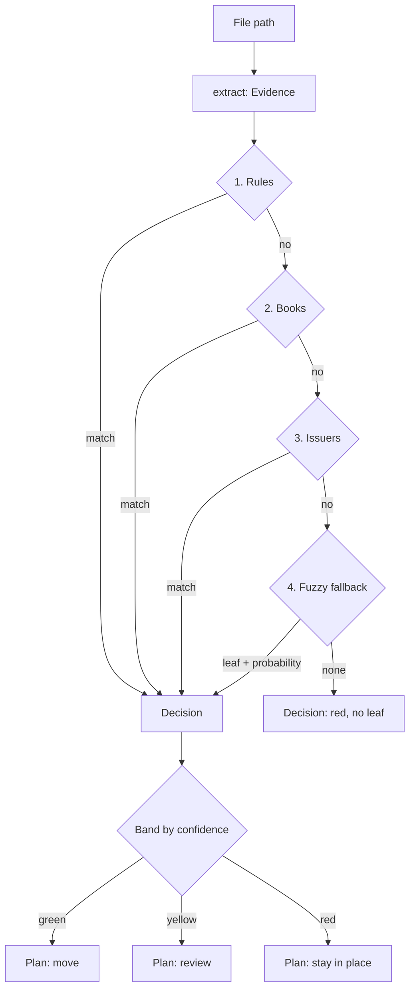

# para-files Redesign — Design Spec

**Date:** 2026-10-10 (amended 2026-10-11)
**Status:** Approved 2026-10-10. Amendment of 2026-10-11 (mission, content kinds, preliminary bake-off) awaiting owner review.
**Approach:** B — staged rebuild around a canonical tree

---

## 1. Context and Intent

### What the owner said

| Topic | Answer |
|---|---|
| Audience | Personal tool — "just me". Generality, onboarding, packaging for others are cost, not value. |
| Pains | Wrong/inbox routing; don't trust moves; slow / Ollama friction. (Config editing friction: *not* a pain.) |
| Core workflows | Recurring inbox drain; library (book) curation; re-org of files already in PARA. Bulk backlog cleanup is *not* core. |
| AI backend | Decide from evidence (bake-off). Cloud models acceptable with zero data retention (ZDR) enforced. |
| Approach | B — staged rebuild (all six design sections approved). |
| Retention prefixes | Keep them in folder names (`5y_factures`, `10y_banques`), but make the scheme consistent. |
| Mission (2026-10-11) | **Records file themselves; everything else is suggested.** Recurring admin records (payslips, invoices, bank, tax, insurance) are filed automatically at ≥ 98% precision; books via ISBN. Every other file gets a suggested destination the owner confirms. |
| `4_Archives` (2026-10-11) | The retention vault (`10y_`, `5y_`, `2y_`, `ret_`, `ctr_`). Legacy unprefixed twins (`factures`, `banques`, `travail`, …) merge into their prefixed folders through a reviewed, journaled migration. |
| Scope (2026-10-11) | Records, books, vendor docs and courses, photos and videos, and suggestions for Areas/Resources. |
| Working source (2026-10-11) | `0_Inbox` is the main working source. The owner files project material by hand. |

### PARA, as this tool uses it

Forte's PARA organizes by actionability ("where will I use this?"), not by subject: Projects are short-term efforts with a goal, Areas need ongoing attention, Resources are topics of interest, Archives hold what is no longer active. PARA says nothing about retention periods.

This tool keeps PARA for Projects, Areas and Resources, and deliberately uses `4_Archives` for something PARA does not define: records under Swiss legal retention periods (CO Art. 127/128, see `taxonomies/models.py`). The tree therefore holds four kinds of content, each with its own policy:

| Kind | Examples | Policy |
|---|---|---|
| `record` | payslips, invoices, bank, tax, insurance, civil-status papers | issuer + document type + year decide; automatic at ≥ 98% precision |
| `library` | books, vendor documentation, courses, certificates | books by ISBN; vendor docs by vendor/issuer match; otherwise suggested |
| `media` | photos, videos | by extension and EXIF year |
| `knowledge` | Areas and Resources material (decks, notes, configs) | always suggested, never moved automatically: only the owner knows actionability |

### Assumptions (owner may correct)

- The PARA root lives on the OneDrive-synced volume referenced in `.env`; all moves stay on that volume.
- Volume of files per inbox drain is hundreds, not tens of thousands — sequential moves are fast enough.
- The owner edits YAML config by hand (or via Claude); no in-app config editor is needed.

---

## 2. Audit Summary (2026-10-10)

Five read-only audits covered pipeline/classifiers, CLI/mover/learning, utils/config/deps, routing config data, and progress/docs/tests.

### Effectiveness

The only real-world run on record (`move`, 327 files, v1.1, 2026-03-02):

| Outcome | Files | Share |
|---|---|---|
| `0_Inbox` @ 80% (extension catch-all; 146 are `.zip`) | 201 | 61.5% |
| `0_Inbox` @ 0% (nothing matched; mostly PDF/Office) | 70 | 21.4% |
| Routed to `3_Resources` / `4_Archives` | 56 | **17.1%** |

The rules engine fired on ~0.3% of files (PRD target ≥ 60%). All 7 low-confidence routes inspected were wrong. No accuracy test exists anywhere in the suite.

### Root causes

1. **No canonical target tree.** `personal_file_tree.yaml` contains only `routing_rules` (327 rules, 1792 globs, 291 free-form destinations, 73 second-level folders with synonyms). Each signal invents its own path, so the same issuer lands in different folders depending on which signal fired (e.g. certificates have five homes).
2. **Classification has side effects.** `pipeline.classify_file` OCR-renames generic PDFs on disk (default `enabled=True, dry_run=False`), so `scan` and `move --dry-run` mutate files. ISBN lookups, geocoding and per-file re-embedding run inside classification.
3. **No measurement.** Confidence values are mostly constants and never gate anything; cascade order alone decides. Progress was tracked by phases and test counts (1489 passing, 81% coverage), not by routing accuracy.
4. **Personal config mixed into code and a public repo.** Personal identifiers (names, account/customer numbers, property names) sit in `config/personal_file_tree.yaml` and in hardcoded blacklists in `classifiers/book_detector.py`.

### Safety defects (current code)

- Read-only commands rename files (OCR rename inside `classify_file`).
- Stale path after rename → mover fails with "Source file does not exist".
- Parallel `move` can silently overwrite (non-atomic conflict check + `shutil.move`, 4 workers default).
- `--rollback` is a no-op; no journal; no undo.
- `rescan` can pull curated files out of `3_`/`4_` into `6_unclassified`.
- Ctrl+C is swallowed and returns DEFAULT → current file moved to `6_unclassified`.
- LLM path output not sanitized and mover has no `para_root` containment check.
- litellm exceptions are not caught → one error aborts the cascade; circuit breaker never trips.
- `bookstore` deletes same-ISBN files even when content differs.
- `learn` / `add-*` rewrite the YAML with `yaml.safe_dump` (strips all comments, non-atomic).

### Dead or orphaned

- The learning loop: the pipeline reads only `routing_rules`; `learn`, `add-utterance`, `add-issuer`, `routes`, `test-route`, `init --subfolders` act on tree sections that do not exist. `FeedbackTracker` is write-only; `PatternExtractor` is test-only.
- `nfo_parser` (0 callers), `BatchMover`, `migrate` (one-shot), `utils/__init__` re-exports, `validated_db_path`, MLX config leftovers, ~1.5k lines of unused functions.
- Unused dependencies: `einops`, `faker`, `bandit`; `semantic-router` (62 transitive packages) used only as a base class.

### Progress

- All product work happened 2025-12-25 → 2026-03-22. Releases v1.3–v1.6 contain only dependency/CI changes. ~22% of all commits are planning documents.
- VISION Horizon 1: 0/5 Mac-native signals, 0/3 "smarter classification" items, no undo.
- Docs describe at least seven different pipelines and still claim MLX / macOS-only.

### Tree inventory (2026-10-11)

Read-only inventory of the PARA root (counts only):

- `2_Areas` 11 folders, `3_Resources` 27, `4_Archives` 66 (+14 loose files). Outside PARA: `5_others`, `6_unclassified` (180 loose files), `others`, `JTI`, `logs`.
- **Half-done retention migration in `4_Archives`:** legacy folders sit next to their prefixed twins: `factures` (~2.2k files) beside `5y_factures` (~2.7k), `banques` (~2k) beside `10y_banques` (~2.2k), and the same for `travail`, `prevoyance`, `dons`, `fiscalite`, `impots-france`, `crypto`, `immobilier`, `administratif`, `juridique`, `loisirs`, `voyages`.
- **Placeholder bugs on disk:** literal folders `3_Resources/documentation/{technology}` and `4_Archives/5y_travail/{year}`; some folder names end with a space.
- **Same topic in several buckets:** `administratif`, `carriere`, `immobilier`, `IT`, `mindmaps`, `sante`, `prevoyance`, `photos`, `videos`.
- **Libraries and media:** `livres` (~4.3k, Thema), `docs` + `documentation` (~11k vendor docs), `formations` (~2.9k); `4_Archives/photos` (~26k) and `videos` (~3.7k).
- **Secrets on disk:** a credentials folder under `2_Areas/IT` and secret-named files in `0_Inbox`.
- **Real inbox:** 110 files; 29 belong to 8 recurring families (payslips 16, card invoices 3, vendor decks).

### Preliminary bake-off (2026-10-11)

206 files already filed (2 per first-level folder, 103 labels), identical evidence for every candidate (filename + 2000-char preview incl. archive listing). Cloud requests forced `provider: {"zdr": true}`. Throwaway harness, read-only on files.

| Candidate | Exact folder | Top-10% most confident: precision | p50 latency | $/1000 files |
|---|---|---|---|---|
| Old pipeline, signals 1–3 (semantic and LLM off) | 42% | 40% | 0.19 s | 0 |
| Claude Sonnet 5.5 (reasoning effort low) | 36% | 85% | 2.1 s | 13.88 |
| Gemini 3.8 Flash (reasoning effort low) | 34% | 80% | 3.2 s | 4.22 |
| Jev 1.13 (Decisions API) | 28% | 50% | 0.35 s | 0.22 |
| Claude Haiku 5.5 (reasoning disabled) | 24% | 55% | 1.9 s | 0.69 |
| gemma4:e4b (local, Ollama) | 17% | 65% | 24.7 s | 0 |
| nomic-embed-text cosine | 5% | 5% | 0.06 s | 0 |

- No candidate reaches 98% precision at any useful coverage. Even when the old pipeline and Jev agree, 38% of those files are wrong: the labels (today's tree) are the bottleneck, not the model.
- **With twins merged, by kind (old pipeline):** records 50% → 66% exact and 56% → 75% precision when it decides; knowledge stays at 26–36% for every method. Residual record errors are records pulled into `livres`/`docs` by the book detector and broad rules, retention-class mix-ups (tax filed as invoice), and the extension catch-all.
- Haiku 5.5 reasons by default and returned empty answers under a 200-token cap until `reasoning: {"enabled": false}` was set.
- Sonnet 5.5 and Gemini 3.8 Flash reject `reasoning: {"enabled": false}`; they ran with `{"effort": "low"}` and a 4000-token cap, so the comparison with Haiku and Jev is not strictly like for like. With twins merged, both reach 40% exact. On `knowledge` files they reach 46% (Sonnet) and 51% (Gemini), against 33% for Jev and Haiku and 26% for the old pipeline. On records they reach about 36%, against 66% for the old pipeline: records stay with rules and issuers.
- Mistral was dropped by the owner; nomic embeddings are dropped on this evidence.
- gemma4:e4b took 78 minutes for the 206 files, and 50 of them failed with the Ollama server disconnecting. Its top-10% figure covers about 20 files. On this evidence the owner dropped local AI (2026-10-11): no local model in the bake-off or in the new core.

---

## 3. Goals, Non-Goals, Success Criteria

### Goals

1. **Trust:** nothing changes on disk without `--apply`; every applied change is journaled and undoable; nothing is ever overwritten or hard-deleted.
2. **Accuracy:** every destination comes from one closed list of leaves; automatic moves happen only for `record`, `library` (ISBN or vendor match) and `media` leaves, are measured, and are held to ≥ 98% precision. `knowledge` files are suggested, never moved automatically.
3. **Speed:** one evidence extraction per file; network and model calls cached; no local model (dropped 2026-10-11, §2).
4. **Simplicity:** 4 signals instead of 6; 6 commands instead of 18; roughly half of today's 18.8k source lines.

### Non-Goals

- VISION Horizons 2–5 (completeness tracker, tax-prep, document graph, household, watch daemon).
- New signals (xattr `kMDItemWhereFroms`, Spotlight, QR-bill, IBAN, `.eml`). Candidates for later, measured against the golden corpus.
- Packaging for other users (Homebrew formula, community templates, onboarding docs).
- In-app learning or config editing.

### Success Criteria

| # | Criterion | How verified |
|---|---|---|
| S1 | Green precision ≥ 98% on the golden corpus, for every kind | `scripts/eval.py` |
| S2 | Green coverage on the golden corpus ≥ the old pipeline's correct-routing rate on the same corpus | `scripts/eval.py`, old vs new |
| S3 | Records: green coverage ≥ 80% of the inbox's recurring records (issuer families) on a real `0_Inbox` run | `sort --json` summary |
| S3b | Knowledge: top-3 suggestion hit rate measured and reported (no threshold until the Stage 1 baseline) | `scripts/eval.py` |
| S4 | A preview run leaves the file tree byte-identical (names, inodes, mtimes) | integration test on a temp tree |
| S5 | `undo` after an apply restores a byte-identical tree | integration test on a temp tree |
| S6 | No personal identifiers in tracked files | manual review before Stage 1 merge |
| S7 | `uv run pytest` passes from a clean clone, without Ollama or network | CI |
| S8 | A file flagged as secret is never sent to any network signal and never moved | unit test on the secrets guard |

---

## 4. Design

### 4.1 Canonical Tree and Configuration

#### Leaves

Every classifier returns a `leaf_id` from a list the owner controls. Free-form paths are impossible by construction.

```yaml
# ~/.config/para-files/tree.yaml
leaves:
  telecom_invoices:
    kind: record
    retention: 5y
    path: 4_Archives/5y_factures/Telephonie
    subkey: "{issuer}/{year}"
    describe: "Phone, mobile and internet invoices"
    keywords: [facture, invoice, abonnement]
  books:
    kind: library
    path: 3_Resources/livres
    subkey: "{thema}"
    describe: "Books and ebooks"
  photos:
    kind: media
    path: 3_Resources/photos
    subkey: "{year}/{month}"
    describe: "Photos and screenshots"
```

| Field | Required | Rule |
|---|---|---|
| key (`leaf_id`) | yes | unique, snake_case |
| `kind` | yes | `record`, `library`, `media` or `knowledge` (see §1) |
| `retention` | `record` only | `permanent`, `ret`, `10y`, `5y`, `2y` or `ctr` |
| `path` | yes | bucket + at most 2 levels; starts with a `1_`–`4_` bucket (never `0_Inbox`) |
| `subkey` | no | at most 2 segments; placeholders limited to `{year}`, `{month}`, `{issuer}`, `{thema}` |
| `describe` | yes | one line; used as the choice criterion by the fuzzy fallback |
| `keywords` | no | used by the issuer signal for agreement |

- Target: 20–30 leaves.
- **Unfillable subkey → leaf root.** A missing issuer or date never rejects a match (fixes the photo/GPS bug).
- **Retention prefixes** come from data, not code: a `record` leaf with `retention` other than `permanent` must live at `4_Archives/<retention>_<name>/…`, and the loader rejects a mismatch. `permanent` records keep their owner-chosen path (e.g. `2_Areas/Officiel`, which stays where it is). Prefixes anywhere else (today `3_Resources/5y_screenshots`, `3_Resources/ret_prevoyance`) are reported by `tree --validate`.
- **Band caps by kind:** `knowledge` leaves are capped at yellow. `library` leaves go green only on ISBN or vendor/issuer match. `record` and `media` leaves follow the per-signal thresholds.
- One extractor per placeholder: one `extract_year`, one `extract_month`, issuer from the issuer signal, thema from the book signal.

#### Config files

All personal config lives under `~/.config/para-files/`. The repo ships only generic defaults and a sanitized `examples/` directory.

| File | Holds | Replaces |
|---|---|---|
| `tree.yaml` | leaves | free-form destinations in 327 rules |
| `rules.yaml` | `{name, leaf, globs[]}` — filename globs → leaf | `routing_rules`, `ExtensionRouterClassifier` hardcoded map |
| `issuers.yaml` | `{issuer: {patterns[], leaves[]}}` | `documents.json` issuers, YAML `issuers`/`known_vendors`, `book_detector` blacklists |
| `golden.jsonl` | golden corpus (see 4.5) | — |
| `.env` | settings (para root, fallback model, thresholds, workers) | — |

Package data (via `importlib.resources`):

- `default_rules.yaml` — generic extension rules (images, video, audio, archives, ISOs, code), appended after user rules.
- `thema_l1l2.json` — Thema level-1/level-2 codes with short names, plus the subject-keyword map now hardcoded in `thema_lookup.py` (~10KB, replaces the 3.6MB `thema.json`).

#### Loading and validation

Loading is strict; violations are errors:

- unknown `leaf_id` referenced by a rule or issuer
- duplicate issuer pattern across issuers (today 26 silent collisions)
- unknown YAML keys (`extra="forbid"`)
- leaf `path` outside the allowed buckets or deeper than allowed

`tree --validate` adds warnings:

- shadowed globs (a glob fully covered by an earlier rule)
- globs with ≤ 3 literal characters
- issuer patterns with ≤ 3 characters
- leaves no rule or issuer points to
- retention-prefix scheme deviations

Glob matching is case-insensitive (removes 28 case-variant duplicates).

#### Settings precedence

`pydantic-settings` sources: **env > `.env` > YAML > defaults**, via `settings_customise_sources`. Fixes today's bug where YAML beats env. `MLXConfig`, the `PARA_FILES_MLX_*` prefix, the hardcoded embedding model and the Ollama URL are removed (no local model).

> The precedence fix and the `.env` correction (`PARA_FILES_PARA_ROOT` currently points at `…/PARA/0_Inbox`) must ship together. Fixing precedence alone would route every file under `0_Inbox/…`.

#### Migration (one-time script)

`scripts/migrate_config.py` (throwaway, not a command):

1. Read the current YAML rules and `documents.json`.
2. Propose a mapping from the 291 current destinations to leaves, informed by the folders that actually exist on disk: legacy twins fold into their prefixed folder, synonym pairs merge, and every leaf gets a proposed `kind` (and `retention` for records).
3. The owner reviews and edits the mapping.
4. Emit `tree.yaml`, `rules.yaml`, `issuers.yaml`, pruning dead rules, shadowed rules, `*_v2` copies and short substring globs.

Files already filed under old paths reach their canonical leaves through the normal re-org flow (`sort` over `3_`/`4_`, see 4.4).

### 4.2 Pipeline

Classification is pure: no renames, no file writes, no geocoding.



#### Evidence

`extract(path) -> Evidence` runs once per file; every signal reads the same object.

| Field | Source |
|---|---|
| `name`, `ext`, `size`, `mtime`, `birthtime` | filesystem |
| `text_preview` (≤ `content_preview_chars`) | pypdf / Office readers / OCR (read-only) |
| `doc_meta` (title, author, subject, dates) | PDF / EPUB / MOBI / CHM metadata |
| `isbns` | one ISBN extractor (pattern + checksum) |
| `exif_date` | EXIF |
| `archive_listing` | names of entries inside `.zip` / `.7z` / `.tar*` (no extraction) |
| `sha256` | content hash (also the cache key) |

#### Signals

| # | Signal | Decides from | Confidence |
|---|---|---|---|
| 1 | Rules | user globs, then package default extension rules | 1.0 (owner-asserted) |
| 2 | Books | ISBN + coherent lookup (title/author match); ebook publisher/subject heuristics move here | 1.0 with ISBN; otherwise book-score, capped at yellow (the preliminary bake-off showed records pulled into `livres` without ISBN) |
| 3 | Issuers | issuer pattern in `name` or `text_preview`; leaf chosen among the issuer's `leaves` by keyword agreement | high when issuer and keyword agree; medium otherwise |
| 4 | Fuzzy fallback | bake-off winner, choosing only among leaf ids | calibrated probability from the model |

First signal returning a decision wins. Signals 1–3 are deterministic and local except the ISBN lookup (cached).

Keyword-only matches (keywords present, no issuer) no longer decide on their own: they are left to signal 4, which receives each leaf's `describe` and `keywords` as choice criteria. The eval baseline (signals 1–3 only) measures what this costs.

Signal 4 interface:

```python
class Fallback(Protocol):
    def decide(self, evidence: Evidence, leaves: Sequence[Leaf]) -> tuple[str, float] | None: ...
```

Implementations are written only for the bake-off winner. Candidates:

- **LLM via litellm** (Gemini 3.8 Flash or Claude Sonnet 5.5 on OpenRouter, with `reasoning: {"effort": "low"}`): JSON-schema output with an enum of leaf ids; self-reported confidence.
- **Jev via OpenRouter Decisions API** (`POST /api/alpha/decisions`, model pinned to `typesafe/jev-1.13`): one `choice` question whose criteria are the leaves' `describe`; returns a probability per leaf. Several questions about the same file can share one request; files are parallelized as separate requests.

Every cloud request carries `provider: {"zdr": true}`, so it fails rather than reach a provider that retains data.

#### Decision

| Field | Meaning |
|---|---|
| `leaf_id`, `target_dir` | leaf and resolved directory (subkey filled or leaf root) |
| `band` | `green` / `yellow` / `red` |
| `confidence`, `signal` | winning signal and its confidence |
| `evidence_summary` | what matched (rule name and glob, issuer and pattern, ISBN, model probabilities) |
| `suggested_name` | optional: `Author - Title (Year)` for books; OCR-derived for generic PDF names. Applied only at apply time. |

#### Bands

Per-signal thresholds in settings, defaults set from the Stage 1 eval:

- **green** → moved on `--apply`
- **yellow** → listed for review; moved only after confirmation (`sort --review`)
- **red** → the file stays where it is

The kind caps of §4.1 apply after the thresholds, so a `knowledge` decision is at most yellow.

There is no `6_unclassified` bucket and no extension catch-all. A re-org never pulls a curated file out of its folder.

#### Robustness and caching

- Any exception inside a signal is logged and the next signal runs. Network signals sit behind the circuit breaker.
- `KeyboardInterrupt` propagates: the run aborts and the current file is untouched.
- SQLite cache at `~/.cache/para-files/cache.sqlite`:
  - ISBN lookups keyed by ISBN.
  - Decisions keyed by `(sha256, config_fingerprint)`, where the fingerprint hashes `tree.yaml`, `rules.yaml`, `issuers.yaml` and the fallback model id. A preview followed by `--apply` pays for model calls once.
- The unused `isbnlib.cover()` network call is removed.

#### Removed from the pipeline

Semantic classifier (5% accuracy in the preliminary bake-off), `TechnologyExtractor` and the `{technology}` placeholder (vendors become issuers), geolocation, `ExtensionRouterClassifier` (becomes default rules), `book_detector` blacklists, `TaxonomyClassifier`'s `RETENTION_PREFIXES`, the 3.6MB Thema load.

### 4.3 Moves and Safety

#### Plan and apply

`sort` builds a `Plan` (list of decisions with source and target) and prints it. Nothing changes without `--apply`. Every mutating command previews by default.

Classification runs in a thread pool (`max_workers`); **apply is single-threaded**. Sequential moves remove the overwrite race without locks.

#### Apply, per operation

1. **Containment:** `target.resolve()` must be inside `para_root.resolve()`; otherwise the operation is refused and reported.
2. **Rename:** apply `suggested_name` (sanitized via `sanitize_filename`).
3. **Conflict:**

   | Target state | Action |
   |---|---|
   | free | move |
   | exists, same sha256 | move source to `<para_root>/.trash/<run-id>/<relative source path>` |
   | exists, different content | move with ` (2)`, ` (3)`… suffix |

4. **Journal:** append one JSONL line and flush.

Nothing is ever hard-deleted or overwritten.

#### Journal

`~/.local/state/para-files/journal/<run-id>.jsonl`, `run-id = YYYYMMDD-HHMMSS`.

```json
{"run_id": "20261010-213000", "op": "move", "src": "...", "dst": "...", "sha256": "...", "size": 1234, "leaf": "telecom_invoices", "signal": "issuers", "confidence": 0.9}
```

`op` ∈ `move`, `trash`, `rmdir`.

#### Undo

`undo [RUN_ID]` (default: last run) replays the journal in reverse. For each entry it checks that `dst` exists with the recorded sha256 and that `src` is free; it skips and reports otherwise. `rmdir` entries recreate directories.

#### Empty-directory cleanup

- `sort --apply` removes only directories emptied by the current run, only inside the paths given to the command.
- `clean --apply` removes empty directories under its PATH, whatever emptied them.
- Both journal removals as `rmdir`.

#### Skipped paths

`sort` and `clean` never descend into dot-directories (`.trash`, `.git`, …) or follow symlinks.

#### Secrets guard

Before any signal runs, `extract` checks the filename and the text preview against secret patterns (private-key headers, cloud access keys, credential/password/token/recovery-phrase markers with a value). A match makes the decision red with reason `secret`:

- the file is never passed to signal 4 or to any other network call, and its preview is not cached;
- it is never moved, renamed or trashed by `sort` or `clean`;
- `sort` lists it under a "secrets" heading so the owner can move it to a password manager; `explain` shows which pattern matched.

Field names without a value (for example a switch config's password-policy settings) do not match.

#### Config is read-only to the tool

No command writes YAML. Corrections are made by editing `rules.yaml` / `issuers.yaml`; `explain` points at the entry to change.

### 4.4 CLI

| Command | Behavior | Absorbs |
|---|---|---|
| `sort [PATH…] [--apply] [--review] [--json] [-w N]` | Classify and plan; default PATH is `0_Inbox`. A file moves only if green (or yellow and confirmed under `--review`) **and** its current directory differs from the target. Covers inbox drain, book curation and PARA re-org. | scan, classify, move, inbox, rescan, bookstore |
| `explain FILE` | Evidence, every signal's verdict, why the winner won, which config entry to edit. No side effects. | `classify -v`, test-route, learn (read side) |
| `undo [RUN_ID]` | Reverse a run from its journal | `move --rollback` |
| `clean [PATH] [--duplicates] [--apply]` | Junk files, empty directories, identical duplicates → `.trash`. Preview by default. | clean, dedupe |
| `tree [--validate]` | Leaves with rule/issuer counts, effective settings and their sources, validation warnings | tree, routes, issuers, config |
| `init` | Create leaf directories and `0_Inbox` from `tree.yaml` | init |

Deleted: `migrate`, `learn`, `add-issuer`, `add-utterance`, the `main.py` re-export shim. Entry point: `para_files.cli.app:app`.

One parallel executor, one band-grouped printer, one JSON shape shared by all commands.

### 4.5 Measurement

#### Golden corpus

- Built from files already filed in PARA, labeled through the Stage 1 destination → leaf mapping. Ambiguous folders excluded.
- Up to ~10 files per leaf (~250 total). Files stay in place; the corpus stores paths, expected leaf ids and kinds.
- Weighted like the real inbox: records from recurring issuer families (payslips, card and utility invoices, bank, insurance, tax) come first; `knowledge` files are labeled too but scored only as suggestions.
- Stored at `~/.config/para-files/golden.jsonl` (personal paths stay out of the repo).
- The repo holds a small sanitized fixture set for CI regression of signals 1–3.

#### `scripts/eval.py` (developer tool)

Reports per signal, per kind and overall: accuracy, green precision, green coverage, yellow/red share, precision-vs-coverage curve per signal (used to set band thresholds), top-3 suggestion hit rate for `knowledge`, latency p50/p95, cost per 1000 files.

#### Bake-off (fills signal 4)

| Item | Value |
|---|---|
| Candidates | In the owner's order of preference: Gemini 3.8 Flash, Claude Sonnet 5.5 (both OpenRouter, enum-constrained, reasoning effort low), Jev 1.13 (Decisions API); plus the **no-fallback baseline** (signals 1–3 only). Mistral, nomic-embed-text, gemma4 (local AI) and Haiku 5.5 dropped after the preliminary run. |
| Input | identical: evidence text (name, 2000-char preview, archive listing) + leaf list with `describe` |
| Privacy | `provider: {"zdr": true}` on every cloud request; secrets-guarded files never sent |
| Code | throwaway, read-only on files |
| Scope | (a) `record`, `library` and `media` files left undecided by signals 1–3; (b) `knowledge` files as suggestions |
| Winner | (a) highest green coverage at ≥ 98% precision; (b) highest top-3 hit rate. Ties → owner preference: Gemini 3.8 Flash > Sonnet 5.5 > Jev 1.13 |
| Drop rule | if no candidate adds ≥ 5 points of green coverage on (a) over the baseline and none beats the baseline's suggestions on (b), signal 4 is removed |

Runs:

1. **Preliminary (done 2026-10-11):** labels were current first-level folders with synonyms merged (`livres`/`books`, `formation`/`formations`, `docs`/`documentation`). Results in §2: the current tree, not the model, limits precision.
2. **Authoritative (Stage 1):** on canonical leaves and the golden corpus.

Reference prices at time of writing (OpenRouter, USD per million tokens, input/output): Gemini 3.8 Flash 0.375/1.875, Claude Sonnet 5.5 2/10, Jev 1.13 0.042/0. Measured in the preliminary run with a 103-label list, per 1000 files: Gemini $4.22, Sonnet $13.88, Jev $0.22 (Haiku $0.69). Cost does not decide.

---

## 5. Stages

Each stage is shippable, has explicit exit checks, and gets its own implementation plan.

### Stage 0 — Safety hotfixes (current code)

One small PR, one test per fix.

1. `ocr_rename.enabled` defaults to `False`.
2. Mover: `para_root` containment check; refuse to overwrite; moves run sequentially.
3. Pipeline: catch `Exception` at the signal boundary (litellm errors no longer abort; breaker records failures); `KeyboardInterrupt` re-raises.
4. LLM output: reject paths containing `..` or absolute paths.
5. `bookstore`: never delete a same-ISBN file whose content differs.

Exit: tests for each fix pass; existing suite green.

### Stage 1 — Canonical tree, golden corpus, bake-off

1. `scripts/migrate_config.py` → draft mapping (with `kind` and `retention`) → owner review → `tree.yaml`, `rules.yaml`, `issuers.yaml` in `~/.config/para-files/`. `issuers.yaml` is seeded from the inbox's recurring families and the existing `documents.json` issuers.
2. Remove personal config and identifiers from tracked files; add sanitized `examples/`.
3. `golden.jsonl` + `scripts/eval.py` (per-kind metrics); baseline the old pipeline.
4. Authoritative bake-off → choose signal 4 (or drop it).
5. **Tree-cleanup plan (generator only):** a reviewable JSONL/CSV of moves that folds legacy twins into their prefixed folders, renames the literal `{technology}`/`{year}` folders and trims trailing spaces. Nothing is applied in Stage 1; applying needs the Stage 2 journal and `undo`.

Exit: owner-approved tree; eval baseline recorded; signal 4 decision recorded; tree-cleanup plan reviewed by the owner.

### Stage 2 — New core (alongside the old pipeline)

Evidence extractor with the secrets guard; signals 1–4 on leaf ids; bands with kind caps; SQLite cache; strict config loader with the precedence fix **and** the `.env` correction; plan/apply executor; journal; `undo`.

Exit: S1, S2, S4, S5, S8 pass.

### Stage 3 — CLI cut-over

Six commands; old commands and modules deleted; apply the reviewed tree-cleanup plan (twin merge) through the journaled executor; PARA re-org (`sort` over `3_`/`4_`: preview → apply, bucket by bucket, with `undo` available).

Exit: S3 measured on a real inbox; re-org completed or explicitly paused.

### Stage 4 — Purge

- Dead code from the audits; local-AI code (`encoders/ollama_encoder.py`, `classifiers/semantic_classifier.py`, Ollama defaults); dependencies `einops`, `faker`, `bandit`, `semantic-router`, `geopy` (re-check `cryptography` and `pymupdf`).
- Docs reduced to ~5 pages (README, architecture, configuration, CLI, ADR index) + ADR-013 recording this redesign and the end of local AI (supersedes ADR-010; ADR-012 already records the records/PARA decision); VISION, PRD and `.planning/` moved to `docs/archive/`.
- Remove `Formula/` and the failing `update-formula` release job, `TODO-routing-fixes.md`, `docs/how-to-better-claude-code.md`; untrack `.serena/` and `.claude/`.

Exit: S6, S7 pass; source ≈ half of 18.8k lines.

---

## 6. Process Changes

- Version bumps and releases only for product changes; Dependabot merges never cut a release.
- Each release's CHANGELOG entry records the eval numbers (green precision, green coverage, inbox green share).
- Specs and plans live in `docs/superpowers/`; the GSD `.planning/` ceremony stops.
- `uv run pytest` works out of the box (dev dependencies in the default group); CLI tests mock the network and never read the owner's `.env`.
- Tests for deleted code are deleted with it.

---

## 7. Risks

| Risk | Mitigation |
|---|---|
| Jev Decisions API is alpha (`/api/alpha/`) | Pin `typesafe/jev-1.13`; `Fallback` protocol isolates it; bake-off includes non-Jev candidates |
| Golden labels inherit inconsistent historical placement | Owner reviews the mapping; ambiguous folders excluded |
| Re-org moves many files on a synced volume | Preview first; apply bucket by bucket; journal + `undo`; `.trash` on the same volume |
| Precedence fix flips `para_root` | Ships together with the `.env` correction (Stage 2) |
| Cloud fallback sends document text off the machine | `provider: {"zdr": true}` on every request; secrets guard; drop rule may remove signal 4 entirely |
| No local model: offline or OpenRouter outage silences signal 4 | Signals 1–3 run locally and still decide records, books and media; undecided files stay in place as yellow/red |
| Twin merge moves thousands of archived files | Plan-only in Stage 1; owner reviews it; applied in Stage 3 through the journal with `undo`, folder by folder |
| Personal identifiers remain in public git history | Owner decided (2026-10-11): the repo stays public and history is not rewritten; new content is checked for identifiers before each push |

---

## 8. Decisions Log

| Decision | Choice |
|---|---|
| Audience | Personal tool |
| Approach | B — staged rebuild |
| Retention prefixes | Kept, consistent scheme under `4_Archives` |
| Pipeline | Pure extract → 4 signals → bands; red stays in place |
| Moves | Preview default, sequential apply, containment, no-clobber, `.trash`, JSONL journal, `undo` |
| CLI | `sort`, `explain`, `undo`, `clean`, `tree`, `init` |
| Learning | Removed; corrections by editing YAML guided by `explain` |
| Bake-off | Preliminary run done 2026-10-11 (tree, not model, is the bottleneck); authoritative run in Stage 1 with Gemini 3.8 Flash, Sonnet 5.5 and Jev 1.13 (owner preference in that order); Mistral, nomic, gemma4 and Haiku 5.5 dropped; GPT-6 Luna excluded (owner does not trust it) |
| Local AI (2026-10-11) | Dropped: gemma4 17% exact, 78 min for 206 files, 50 server disconnects; Ollama removed in Stage 4 |
| Mission (2026-10-11) | Records file themselves; everything else is suggested |
| `4_Archives` (2026-10-11) | Retention vault; legacy twins merged via reviewed, journaled migration |
| Content kinds (2026-10-11) | `record`, `library`, `media`, `knowledge`; `knowledge` never green |
| Secrets (2026-10-11) | Secret-flagged files are never sent off-machine and never moved |
| Repo visibility (2026-10-11) | Stays public; history not rewritten |
